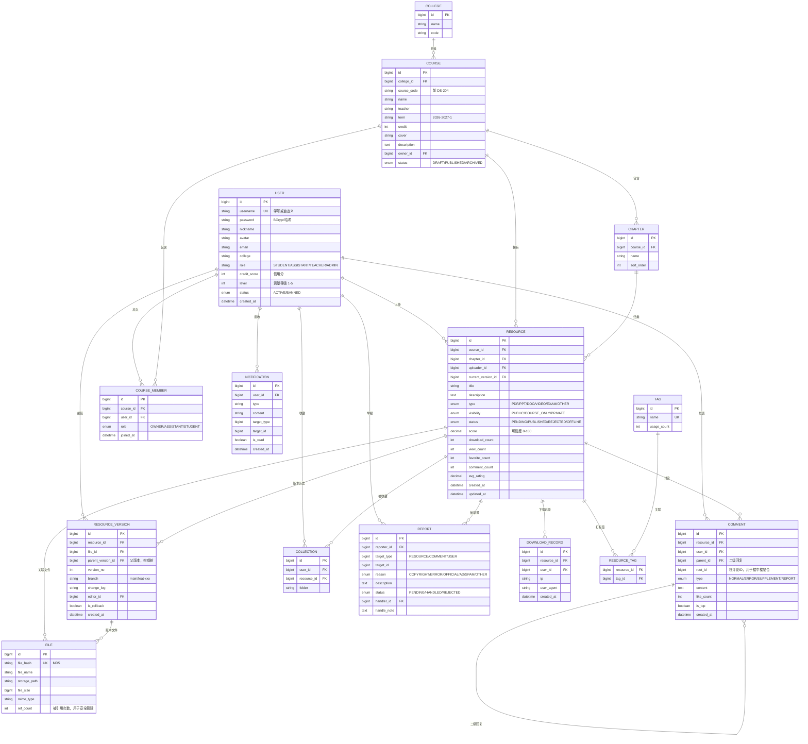

<div align="center">

# CourseHub · 课程资料协作平台

**让每一份资料都有出处，让每一次上传都有价值**

[](https://www.oracle.com/java/)
[](https://spring.io/projects/spring-boot)
[](https://mybatis.org/mybatis-3/)
[](https://www.mysql.com/)
[](https://vuejs.org/)
[](LICENSE)
[](#-贡献指南)

</div>

---

## 📖 目录

- [✅ 实现状态说明（先看这个）](#-实现状态说明先看这个)
- [项目背景与目标](#-项目背景与目标)
- [目标用户与使用场景](#-目标用户与使用场景)
- [核心功能模块](#-核心功能模块)
  - [M1 课程与资料管理](#m1-课程与资料管理)
  - [M2 协作编辑与版本控制](#m2-协作编辑与版本控制)
  - [M3 权限与角色体系](#m3-权限与角色体系)
  - [M4 评论与讨论](#m4-评论与讨论)
  - [M5 智能检索](#m5-智能检索)
  - [M6 质量与内容治理](#m6-质量与内容治理)
  - [M7 激励与个性化](#m7-激励与个性化)
- [整体技术架构与系统设计](#-整体技术架构与系统设计)
- [数据模型与关键实体关系](#-数据模型与关键实体关系)
- [目录结构规划](#-目录结构规划)
- [里程碑与迭代计划](#-里程碑与迭代计划)
- [非功能性需求](#-非功能性需求)
- [快速开始](#-快速开始)
- [后续可扩展方向](#-后续可扩展方向)
- [贡献指南](#-贡献指南)
- [许可证](#-许可证)

---

## ✅ 实现状态说明（先看这个）

> **先说清楚两套编号，别混淆：**
>
> | 编号 | 含义 | 出现在哪 |
> |---|---|---|
> | **M1 ~ M7** | **需求侧**的功能模块编号 | 本文档下面的「核心功能模块」 |
> | **M0 ~ M4** | **开发侧**的交付里程碑编号 | `overview.md`、所有 Git 提交记录 |
>
> 本文档最初是当作「需求规格说明书」写的，描述的是**规划**；
> 实际开发按 M0~M4 推进，**截至 2026-10 已全部完成**。

### 一、已实现（可以直接跑起来体验）

| 能力 | 说明 | 对应里程碑 |
|---|---|---|
| 注册 / 登录 / 退出 | JWT + BCrypt 加密 + 拦截器 + 注解式权限 | M0、M1 |
| 课程管理 | 列表、关键词搜索、学院筛选、详情、增删改、加入 / 退出 | M1 |
| 文件上传下载 | **五重安全校验**、MD5 秒传、引用计数 | M2-1 |
| 资料管理 | 发布、编辑、删除、**三级可见性**（公开 / 仅本课程 / 仅自己） | M2-2 |
| 大文件分片上传 | 秒传、**断点续传**（Redis 记录分片）、合并后 MD5 复验 | M2-3 |
| 中文全文检索 | MySQL **ngram 全文索引** + 相关度排序 + Redis 搜索热词 | M2-4 |
| 版本树 | 查看历史版本、下载历史版本、**回滚（留痕）**、上传新版本 | M3 |
| 评论 | **两级评论**（评论 + 回复）、删除、举报评论 | M3 |
| 收藏 | 收藏 / 取消收藏、我的收藏 | M3 |
| 举报与治理 | 提交举报、管理员按状态筛选并处理 | M3 |
| 可信度评分 | **5 因子加权** + 指数时效衰减 + 定时重算 | M4 |
| 操作审计日志 | AOP 切面，记录操作人 / 对象 / 详情 / 来源 IP | M4 |
| 部署方案 | Nginx + Docker Compose + 环境变量治理 + 上线清单 | M4 |

### 二、尚未实现（需求里写了、当前版本没有）

| 需求项 | 需求编号 | 现状 |
|---|---|---|
| 章节管理（学院 → 学期 → 课程 → **章节** 的第四层） | M1 | 表已建（`chapter`），**无接口与界面** |
| 版本内容对比（diff 两个版本） | M2 | 未实现（版本树本身已实现） |
| 多人协作冲突处理 | M2 | 未实现 |
| 认领机制（认领某门课的维护权） | M7 | 未实现 |
| 订阅提醒 / 通知 | M7 | 表已建（`notification`），**无代码** |
| 贡献者中心 / 排行榜 | M7 | 未实现 |
| 个性化推荐 | M7 | 未实现 |
| 标签体系 | M5 | 表已建（`tag`、`resource_tag`），**无代码** |
| 下载记录明细 | M1 | 表已建（`download_record`），**无代码**（目前只维护 `resource.download_count` 计数） |
| MinIO 对象存储 | 架构 | 接口已抽象（`FileStorage`），**只实现了本地存储**，MinIO 未启用 |
| JUnit 单元测试 | 非功能 | 未编写；目前用 8 套 Python 接口测试脚本（共 210 项）覆盖 |

> **为什么有这些缺口**：本项目的目标是「走一遍完整开发流程 + 沉淀一个能跑的系统」，
> 所以优先把**主干链路**（认证 → 课程 → 文件 → 资料 → 协作 → 治理 → 部署）打通并逐项实测；
> 上面这些增强功能作为后续迭代方向保留，见文末「后续可扩展方向」。

### 三、想验证的话

- `docs/用户操作手册.md` —— 怎么启动、界面上点哪里（含两种启动方式）
- `overview.md` —— 交付总览 + 全部实测证据（210 项测试）
- `docs/完整开发流程手册.md` —— 从零到上线的完整流程与原理

---

## 🎯 项目背景与目标

### 1.1 痛点观察

期末季在校园里的真实场景是这样的：

> 想要的资料在 QQ 群文件里翻了 40 分钟没找到 → 微信群问学长，学长说"我找找" → 三天后收到一个压缩包，名字叫 `新建文件夹 (3).zip` → 解压后发现是别人整理的，但里面缺了三章的课件 → 期末还是靠自己硬啃。

拆开看，这是**四个互相纠缠的问题**：

| 问题 | 具体表现 | 现有方案的缺陷 |
|---|---|---|
| **找不着** | 资料散落在 20+ 个群聊、网盘、个人电脑 | 群聊不可检索，文件一沉底就等于消失 |
| **不敢信** | 群文件来源不明，下载后不知道是谁传的、什么时候传的 | 无作者、无时间、无质量标识 |
| **重复劳动** | 每届学生整理一遍，重复上传相同资料 | 没有复用机制，优秀笔记无法沉淀 |
| **不敢传** | 担心资料被商用、被冒充、被打扰 | 缺少版权声明与举报机制 |

### 1.2 项目定位

CourseHub 是一个**面向高校学生的课程资料协作与沉淀平台**。

它不是"又一个网盘"，而是围绕**课程坐标系**（学院 → 学期 → 课程 → 章节）组织的资料协作工具，核心解决"资料从哪来、能不能信、是否最新、谁维护"四个问题。

### 1.3 项目目标

**功能目标**

| 编号 | 目标 | 验收标准 |
|---|---|---|
| G1 | 建立课程维度的资料归档体系 | 支持学院/学期/课程/章节四级组织 |
| G2 | 实现资料的版本可追溯 | 任意资料可查看全部历史版本并回滚 |
| G3 | 解决"资料太多不知选哪个" | 提供可信度评分与排序机制 |
| G4 | 支撑 100MB 级课件可靠上传 | 分片上传 + 秒传 + 断点续传 |
| G5 | 建立内容质量闭环 | 举报 → 审核 → 处置全流程可追溯 |

**非功能目标**

- 支持 1000 并发用户下的课程资料浏览场景
- 关键接口 P95 响应时间 < 300ms
- 资料检索结果在 500 条数据内响应 < 200ms

### 1.4 差异化设计（我们和"普通网盘"的区别）

这是本项目**最需要在答辩中讲清楚**的部分：

| 差异化点 | 解决的问题 | 实现思路 |
|---|---|---|
| **可信度评分** | 资料太多，不知道该用哪份 | 评分模型 = 文件完整度 × 上传者信用 × 社区评价 × 时效性 |
| **版本树（分支）** | 多人维护同一份资料会互相覆盖 | 图结构版本模型，支持 A、B 同学各自改进后合并 |
| **认领机制** | 某门课的资料有缺口没人补 | 资料位可被"认领待补充"，其他人补齐后自动通知 |
| **隐私分级** | 资料不敢公开 | 三级可见性：完全公开 / 仅本课程 / 完全私密 |
| **课程坐标系** | 资料按时间堆成一堆 | 四级组织 + 学年学期维度，天然适配教学周期 |

---

## 👥 目标用户与使用场景

### 2.1 用户画像

| 角色 | 占比预估 | 核心诉求 | 典型行为 |
|---|---|---|---|
| **学生（普通用户）** | 80% | 快速找到能用的资料 | 搜索 → 筛选 → 下载 → 评分 |
| **资料贡献者（优秀学生）** | 15% | 分享资料、获得认可 | 上传 → 维护版本 → 回答评论 |
| **助教 / 讲师** | 3% | 发放官方课件、管理课程 | 创建课程 → 审核资料 → 置顶公告 |
| **管理员** | 2% | 平台内容安全 | 审核举报 → 处置违规 → 数据看板 |

### 2.2 核心用户故事

**US-01｜期末找资料（最高频场景）**

> 作为大二学生，我距离期末还有 3 周，希望快速找到《数据结构》老师发的往年真题和某位学长整理的高质量笔记。
> 验收：我输入"数据结构 往年真题"，系统按**可信度降序**返回结果，我能看到每个资料的上传人、更新时间、历史版本数、下载量，第一条就是我要的。

**US-02｜上传大文件课件**

> 作为助教，我要上传一份 180MB 的《编译原理》完整课件，同学也会传不同版本。
> 验收：我拖入文件后，看到秒传失败提示（首次上传），进度条走到 100%，中途刷新页面后能**继续上传**而不丢失进度。

**US-03｜发现资料有误**

> 作为学生，我下载了某份《概率论》笔记，发现第 5 章有公式错误。
> 验收：我在资料详情页点击"纠错"，选择"内容有误"并描述问题，上传者收到站内通知，修正后我收到复查通知，资料可信度分回升。

**US-04｜贡献者维护老资料**

> 作为某门课的资料贡献者，我希望在自己上传的资料失效（比如老师换了教材）时收到提醒。
> 验收：系统检测到该课程有新学期开课，推送提醒"您上传的《线性代数》资料距今已 2 年，是否更新？"

**US-05｜老师管理课程**

> 作为《数据结构》任课老师，我希望把课件只发给我选中的学生，而不是全平台公开。
> 验收：创建课程时勾选学生名单，资料可见性选择"仅本课程"，非选中学生访问时返回 403 明确提示。

### 2.3 场景优先级

按**开发优先级**排序（第一个必须做，第四个可以延后）：

| 优先级 | 场景 | 对应模块 |
|---|---|---|
| P0 | 用户注册登录、课程浏览、资料上传下载 | M1、M3 |
| P0 | 资料搜索、详情页、评论 | M1、M4、M5 |
| P1 | 版本控制、可信度评分、权限分级 | M2、M6 |
| P2 | 认领机制、订阅提醒、贡献者中心 | M7 |

---

## 🧩 核心功能模块

> ⚠️ **本节是「需求设计」视角的描述**，用的是需求侧编号 **M1~M7**。
> 哪些已经做完、哪些还没做，请看前面的 [✅ 实现状态说明](#-实现状态说明先看这个)。

### M1 课程与资料管理

**这是系统的主干，其他模块都挂在它上面。**

#### M1.1 课程体系

```
学院 (college)
  └── 课程 (course)  — 归属某个开课学期
        └── 章节 (chapter)  — 可选，部分课程无章节概念
              └── 资料 (resource)
```

- **课程档案**：课程编号、名称、授课教师、学分、开课学期、所属学院、课程封面
- **课程归属**：开课学期 + 授课教师，一个学期同一门课可能有多个班（多教师场景）
- **资料分类**：讲义 / 课件(PDF、PPT) / 往年真题 / 习题答案 / 参考书 / 课程设计 / 其他
- **资料属性**：文件、标签、页数、大小、格式、所属章节

**关键设计**

- 资料以**物理文件 + 元数据**分离存储，数据库只存元数据和文件哈希
- 每份资料必须归属一门课程，**不允许游离资料**（这是与传统网盘的核心区别）
- 资料支持"归集"：多个散落资料可合并为一个合集（如《期末复习包》）

#### M1.2 资料核心功能

| 功能 | 说明 | 复杂度 |
|---|---|---|
| 资料上传 | 单文件 ≤ 500MB，分片上传 | ★★★ |
| 秒传检测 | 基于 MD5 哈希，命中已有文件直接秒传 | ★★ |
| 断点续传 | 刷新/断网后可继续上传 | ★★★ |
| 资料编辑 | 标题、描述、标签、分类、章节、可见性 | ★ |
| 资料下载 | 权限校验 → 记录下载行为 → 计数 | ★★ |
| 资料收藏 | 收藏夹分组 | ★ |
| 资料打包下载 | 选中多份资料 → 生成 ZIP（异步） | ★★ |
| 资料下架 | 作者/管理员主动下架，保留数据 | ★ |

#### M1.3 差异化功能：可信度评分模型

**这是本项目最核心的算法模块。**

我们不按上传时间排序，而是按可信度排序。评分公式：

$$
\text{Score} = \underbrace{W_1 \cdot F}_{\text{文件完整度}} + \underbrace{W_2 \cdot U}_{\text{上传者信用}} + \underbrace{W_3 \cdot R}_{\text{社区评价}} + \underbrace{W_4 \cdot N}_{\text{社区认可度}} - \underbrace{W_5 \cdot A}_{\text{时效衰减}}
$$

| 因子 | 计算方式 | 权重 |
|---|---|---|
| **F 文件完整度** | 是否有版本历史(0.2) + 描述字数达标(0.2) + 标签完整(0.15) + 未被举报(0.25) + 格式规范(0.2) | 0.25 |
| **U 上传者信用** | 基于用户历史：被采纳数、资料下载转化率、违规次数 | 0.20 |
| **R 社区评价** | 平均评分（1-5 星），无评分按全局均值 3.2 兜底 | 0.20 |
| **N 社区认可度** | `log10(下载量 + 1)` 归一化 + 收藏数 + 评论活跃度 | 0.25 |
| **A 时效衰减** | 每学期衰减 15%，超过 2 年显著降权（教学周期特性） | 0.10 |

**为什么要有时效衰减**：资料的有效性依附于**教学周期**。同一份《高等数学》笔记，2024 版和 2026 版价值完全不同。线性降权会导致老资料永远沉底，指数衰减则保留"经典资料"的翻身可能。

**落地实现**：MySQL 定时任务每晚 2:00 全量重算，Redis 缓存 Top 榜单。避免实时计算拖慢查询。

---

### M2 协作编辑与版本控制

#### M2.1 版本模型选择：版本树而非版本链

多数网盘用**线性版本链**（v1 → v2 → v3），但这在协作场景下会崩溃：两个同学同时改一份笔记，后提交的会覆盖前面的。

我们采用**树形版本模型**：

```
v1 (原始上传)
 ├── v2 ──── v3  (A 同学：补充第五章)
 │     └── v4      (C 同学：修正公式错误)
 └── v2' ─── v3'  (B 同学：完全重写第二章)
```

- 每份资料有且仅有一个**主分支**（`main`，线性）
- 其他版本构成**子分支**，标记来源父版本
- 支持**分支对比**与**合并请求**（简化版：管理员/作者审批）

#### M2.2 版本对比

提供两种方式：

| 方式 | 实现 | 适用 |
|---|---|---|
| **文本 Diff** | `java-diff-utils` 算法库，行级差异 + 字符级高亮 | Markdown 笔记、代码 |
| **二进制标记** | 存储文件哈希 + 大小，标记"已变更/未变更" | PDF、PPT |

> 课程项目不做在线实时协同编辑（CRDT 复杂度过高），而是做**"异步协作"**——基于版本分支 + 合并 + 讨论，这是 B 站/掘金等社区的实际做法，也符合课程项目的时间预算。

#### M2.3 冲突处理

| 冲突类型 | 检测方式 | 解决方案 |
|---|---|---|
| 同时编辑同版本 | 提交时校验 `expectedVersionId` | 拒绝并提示"已有新版本"，展示 Diff |
| 版本回滚覆盖 | 记录 `rollbackFrom` 节点 | 保留回滚记录，不物理删除 |

#### M2.4 关键表

```sql
-- 简化示意，完整见 docs/数据库设计.md
resource_version(
  id, resource_id, version_no,     -- 版本号（分支内递增）
  parent_version_id,                -- 父版本，构成树
  branch_name,                      -- main / feat-xxx
  file_id, file_hash,               -- 该版本的文件
  change_log,                       -- 变更说明
  editor_id, is_rollback, rollback_from_version_id,
  created_at
)
```

---

### M3 权限与角色体系

#### M3.1 角色定义

| 角色 | 权限范围 | 典型操作 |
|---|---|---|
| `ROLE_ADMIN` | 全局 | 审核、封禁、看板、配置 |
| `ROLE_TEACHER` | 自己创建的课程 | 建课、审核本课资料、置顶公告、指定助教 |
| `ROLE_ASSISTANT` | 被授权的课程 | 审核本课资料、管理章节 |
| `ROLE_STUDENT` | 公开资源 + 选读课程 | 上传、下载、评论、评分、举报 |

#### M3.2 权限判定链路

```
请求进入
  ↓
① 是否登录？ ──否──→ 公开接口放行 / 受限接口 401
  ↓ 是
② 拦截器解析 JWT → 加载用户与角色集合
  ↓
③ @RequireRole 注解校验：是否具备所需角色？
  ↓
④ 资源级权限校验（关键步骤）：
   ├─ 资源可见性 == PUBLIC           → 通过
   ├─ 资源可见性 == COURSE_ONLY      → 检查用户是否在课程成员表
   └─ 资源可见性 == PRIVATE          → 仅作者本人 + 管理员
  ↓
⑤ 操作级权限：能否编辑/删除/下架？
  （作者本人 / 同课程助教讲师 / 管理员）
  ↓
⑥ 通过 → 执行业务
```

#### M3.3 可见性模型

| 可见性 | 谁能看 | 说明 |
|---|---|---|
| `PUBLIC` 全平台公开 | 所有登录用户 | 优质公共资料默认此项 |
| `COURSE_ONLY` 仅本课程 | 课程成员名单内 | 教师内部资料、历年真题 |
| `PRIVATE` 完全私密 | 仅自己 | 草稿、待整理资料 |

**数据权限与功能权限分离**：`@RequireRole` 管"能不能进这个接口"，资源级校验管"能不能看这条数据"。这是很多同学在答辩时被问倒的点——**只做功能权限不做数据权限，就会出现"改 URL 参数能看到别人资料"的越权漏洞**。

#### M3.4 防越权设计

```java
// 错误写法：只查权限，不查归属
if (currentUserId.equals(resource.getUploaderId())) { ... }

// 正确写法：权限 + 归属双重校验
Resource r = resourceMapper.selectById(resourceId);   // 资源存在
if (!canOperate(currentUser, r)) {                    // 操作权限
    throw new BizException(403, "无权操作该资源");
}
```

所有**更新/删除**接口必须过这一层。仅靠前端隐藏按钮 = 没有权限控制。

---

### M4 评论与讨论

#### M4.1 两级评论结构

```
资料
 └─ 一级评论（对资料整体评价）
     └─ 二级回复（针对具体评论，或指出资料中的具体问题）
```

- 支持 `@提及`（`@学号` 或 `@昵称`）
- 支持 Markdown 与代码块渲染（程序员资料常含代码）
- 支持评论置顶（作者/管理员可置顶说明）
- 已被作者回复的评论显示"作者已回复"标识

#### M4.2 纠错与追问

在评论之上，抽象出**问题类型**字段，让讨论更有结构：

| 类型 | 图标标识 | 用途 | 作者是否收到通知 |
|---|---|---|---|
| 普通讨论 | 💬 | 闲聊、询问 | 否 |
| 纠错反馈 | ⚠️ | 指出内容错误 | **是** |
| 内容补充 | ➕ | 补充遗漏章节 | **是** |
| 举报可疑 | 🚩 | 疑似抄袭/违规 | **是** + 触发审核流程 |

这个设计让"我下载后发现资料有问题"这个动作，从一句模糊的评论变成**结构化的质量反馈闭环**。

#### M4.3 防止评论系统被刷

- 新用户注册 < 24h 内不可评论
- 单用户对同一资料最多保留 1 条一级评论（防止刷屏）
- 评论内容敏感词过滤（简单 Trie 树实现，不引入第三方服务）
- 评论数 Redis 计数，DB 异步落库

---

### M5 智能检索

#### M5.1 检索维度

| 检索方式 | 说明 | 实现 |
|---|---|---|
| **关键词全文检索** | 搜标题、描述、标签、正文 | MySQL FULLTEXT + ngram 解析器 |
| **多维筛选** | 学院 / 课程 / 分类 / 学期 / 文件类型 / 时间范围 | SQL 条件组合 + 索引 |
| **模糊匹配** | 容忍错别字与部分输入 | 拼音首字母 + 内存分词缓存 |
| **关联推荐** | "看了这份的人还看了" | 基于共同课程/共同下载的协同过滤（简化版） |

#### M5.2 中文分词的现实选择

MySQL 8.0 内置 ngram 全文索引，是课程项目**最务实的选择**：

```sql
ALTER TABLE resource
ADD FULLTEXT INDEX ft_resource (title, description, tags)
WITH PARSER ngram;
```

- 优点：零额外依赖、答辩时好讲、8.0 默认支持
- 缺点：分词粒度粗，"数据结构" 可能被切成"数据结/构结/结构"

**备选方案**（有余力再做）：引入 Elasticsearch 7.x，中文分词用 IK Analyzer。设计时预留 `SearchService` 接口，切换实现不影响业务层。

> **关键知识点**：SQL 的 `LIKE '%关键词%'` **无法走索引**，全表扫描；`FULLTEXT` + 索引可以。这也是答辩高频问点——很多同学的搜索功能慢，根因就在这里。

#### M5.3 搜索优化

- 搜索词 → Redis 缓存（TTL 10 分钟）
- 高频搜索词 → 本地 Caffeine 二级缓存
- 搜索结果分页上限 100 页，防止爬虫
- 记录搜索日志，用于"搜索无结果词"分析 → 反向驱动资料补充

---

### M6 质量与内容治理

#### M6.1 内容审核流程

```
用户上传/修改
  ↓
机器初审（自动）
  ├─ 文件类型校验（仅允许 pdf/doc/docx/ppt/pptx/xls/xlsx/zip/md/txt）
  ├─ 文件大小校验
  ├─ 敏感词检测（标题 + 描述 + 文本类文件正文）
  └─ 重复文件检测（哈希比对）
  ↓
通过 → 状态 PENDING（待审核）
  ↓
人工审核（助教/讲师/管理员）
  ├─ 通过 → PUBLISHED（已发布，参与可信度计算）
  ├─ 驳回 → REJECTED（附驳回理由，可修改后重新提交）
  └─ 转入敏感队列 → SENSITIVE（进敏感词库，人工二次确认）
```

#### M6.2 举报与处置

| 处置动作 | 触发条件 | 影响 |
|---|---|---|
| 警告 | 首次轻微违规 | 记录，不影响使用 |
| 下架资料 | 举报核实成立 | 资料转 `OFFLINE`，可信度归零，作者可申诉 |
| 限制上传 | 30 天内 2 次下架 | 上传功能冻结 30 天 |
| 封禁账号 | 恶意上传盗版 / 恶意刷量 | 账号禁用，保留数据以便追溯 |

**所有处置必须可追溯**：每次处置写入 `audit_log` 表，记录操作人、时间、依据、申诉记录。这既是自我保护，也是管理员的工作台。

#### M6.3 版权声明机制

- 上传时必须勾选"本人原创 / 已获授权 / 公开资料"
- 选择"已获授权"需填写来源说明
- 资料详情页展示版权标签
- 收到版权举报 → 立即下架 + 通知双方 + 人工介入

---

### M7 激励与个性化

#### M7.1 贡献者激励

| 机制 | 说明 |
|---|---|
| 贡献等级 | Lv.1~Lv.5，由上传数、被下载数、采纳数、综合计算 |
| 认证徽章 | 「课件整理者」「笔记达人」「纠错高手」等分类徽章 |
| 贡献榜 | 周榜 / 月榜 / 总榜（Redis ZSet 实现） |
| 采纳机制 | 资料被老师标记为"课程推荐" → 大幅提升可信度分 |

#### M7.2 订阅与提醒

| 场景 | 触发条件 | 通知渠道 |
|---|---|---|
| 课程新资料 | 用户订阅的课程有新资料上传 | 站内信 + WebSocket 推送 |
| 资料纠错 | 收到纠错/补充类评论 | 站内信 |
| 认领成功 | 自己认领的资料被别人补齐 | 站内信 |
| 资料过期 | 距上次更新超过 2 个学期 | 站内信 + 邮件（可配置） |
| 课程更新 | 订阅课程的章节/大纲变更 | 站内信 |

#### M7.3 首页个性化

- 猜你想看：基于用户所在学院 + 选读课程 + 浏览历史的混合推荐
- 继续上次：断点续传未完成的任务、历史浏览
- 待办：待确认的纠错、待复习的资料、认领中的资料位

---

## 🏗 整体技术架构与系统设计

### 3.1 架构选型说明

项目指令要求"**传统 Spring 框架 + 前后端分离**"，据此明确以下边界：

| 维度 | 选型 | 不选什么 & 为什么 |
|---|---|---|
| Web 框架 | Spring MVC（`DispatcherServlet` + 注解） | ❌ WebFlux / Spring Boot 3 全虚拟线程：偏离"传统"要求，答辩时不好解释 |
| 持久层 | **MyBatis** + 手写 SQL | ❌ JPA/Hibernate：自动生成 SQL 看不出数据库功底，答辩时"没法展示 SQL 优化" |
| 事务 | `@Transactional`（声明式） | ❌ 编程式事务：代码冗长，无法展示 Spring 核心能力 |
| 安全 | JWT + 自定义拦截器 | ❌ Spring Security 全家桶：配置链路长，流程黑盒，答辩时难以讲清每一环 |
| 前端 | Vue 3 + Element Plus | ❌ React：本次项目团队对 Vue 熟悉度更高 |
| 状态管理 | Pinia | — |

> **一句话解释这些选型**：传统 Spring + MyBatis 的组合，让**每一个环节都可以在答辩时打开源码逐行讲**。这是课程项目相对"全家桶一键生成"的最大优势。

### 3.2 总体架构

```
┌──────────────────────────────────────────────────────────────────┐
│                          浏览器 / 移动端                          │
└───────────────────────────────┬──────────────────────────────────┘
                                │ HTTPS
┌───────────────────────────────▼──────────────────────────────────┐
│                         Nginx（静态资源 + 反向代理）                │
│   /  →  前端 dist 静态文件                                          │
│   /api/  →  后端服务                                                │
└───────────────────────────────┬──────────────────────────────────┘
                                │
┌───────────────────────────────▼──────────────────────────────────┐
│                    Spring Boot 应用（单体，分层架构）              │
│                                                                  │
│  ┌────────────────────────────────────────────────────────┐     │
│  │  Controller 层   @RestController · 参数校验 · 统一响应     │     │
│  └───────────────────────┬────────────────────────────────┘     │
│  ┌───────────────────────▼────────────────────────────────┐     │
│  │  Service 层      业务逻辑 · @Transactional 事务边界       │     │
│  │                  · 权限校验 · 版本管理 · 评分计算          │     │
│  └───────────────────────┬────────────────────────────────┘     │
│  ┌───────────────────────▼────────────────────────────────┐     │
│  │  Mapper 层       MyBatis 接口 + XML                     │     │
│  └───────────────────────┬────────────────────────────────┘     │
│  ┌───────────────────────▼────────────────────────────────┐     │
│  │  Model 层        Entity · VO · DTO                       │     │
│  └────────────────────────────────────────────────────────┘     │
│                                                                  │
│  横切能力：拦截器(鉴权) · AOP(操作日志) · 定时任务 · 全局异常       │
└───────┬──────────────────────┬───────────────────┬──────────────┘
        │                      │                   │
┌───────▼────────┐   ┌─────────▼────────┐  ┌──────▼──────────────┐
│   MySQL 8.0    │   │     Redis        │  │  本地文件系统/MinIO │
│  (元数据+全文)  │   │ (缓存/计数/榜单)   │  │   (资料二进制文件)   │
└────────────────┘   └──────────────────┘  └─────────────────────┘
```

### 3.3 后端分层职责

| 层 | 职责 | 禁止做的事 |
|---|---|---|
| **Controller** | 接收请求、参数校验（`@Valid`）、调用 Service、返回统一响应 | ❌ 写业务逻辑、❌ 直接操作 Mapper |
| **Service** | 业务逻辑、事务边界、权限校验、跨表编排 | ❌ 拼 SQL、❌ 直接操作 HttpServlet |
| **Mapper** | 单表 CRUD + 复杂查询 SQL | ❌ 写业务判断 |
| **Entity/DTO/VO** | 数据库映射 / 入参 / 出参 | ❌ 混用（尤其不要把 Entity 直接返回给前端） |

**为什么必须分 DTO/VO**：Entity 直接返回前端会泄露 `password`、`deleted` 等敏感字段。这是答辩时"你考虑过安全吗"的考察点。

### 3.4 关键技术流程

#### 流程一：大文件分片上传

```
前端                                    后端
 │                                       │
 ├─ 计算文件 MD5（全量或采样）             │
 │                                       │
 ├─ POST /file/upload/init ────────────► │ 查 Redis: hash 是否已存在？
 │  {fileHash, fileName, size, chunks}   │  ├─ 存在 → 返回 {秒传, resourceId}
 │                                       │  └─ 不存在 → 返回 {uploadId, uploadedChunks[]}
 │◄──────────────────────────────────────┤
 │                                       │
 ├─ 已有分片 → 跳过；缺失分片 → 并发上传    │
 │  POST /file/upload/chunk ────────────► │ 写临时目录，Redis 记录分片索引
 │  (uploadId, index, chunk)              │
 │◄──────────────────────────────────────┤
 │  （可随时中断，下次 init 拿到已传分片）  │
 │                                       │
 ├─ POST /file/upload/merge ───────────► │ 顺序合并 → 计算总 MD5 → 校验
 │  {uploadId}                            │ → 移动到正式目录 → 写 file 表
 │                                       │ → 落库 resource → 事务提交
 │◄──────────────────────────────────────┤
 │  显示"上传成功，等待审核"               │
```

**三个必须讲清楚的技术点**：

1. **为什么分片**：单请求传 500MB，一旦网络抖动要全部重传。分片后只需重传失败的那几片。
2. **为什么秒传**：文件哈希命中说明服务器已有相同内容，直接建立 `file` 记录关联，零传输。校园资料重复率极高，秒传能省下 80% 的存储与带宽。
3. **为什么最终要校验 MD5**：分片传输可能因网络问题静默损坏，合并后必须重算全文件哈希与前端声明值比对，不一致则整体失败。这是**数据一致性的最后一道防线**。

#### 流程二：资源下载与权限校验

```
GET /resource/{id}/download
  ↓
① 拦截器：JWT 解析 → 当前用户
  ↓
② 资源存在？ ──否──→ 404
  ↓ 是
③ 数据权限校验（见 M3.3）：
   PUBLIC        → 通过
   COURSE_ONLY   → 查 course_member 是否含当前用户 → 否则 403
   PRIVATE       → 仅作者/管理员 → 否则 403
  ↓
④ 记录下载行为（异步 MQ/线程池，不阻塞主流程）
   ↓
⑤ 返回文件流（支持 HTTP Range 断点续传，支持在线预览 PDF）
  ↓
⑥ 异步：Redis 计数 +1 → 触发可信度分更新队列
```

#### 流程三：可信度评分计算

```
触发时机：新增下载 / 新增评价 / 举报成立 / 每晚 2:00 全量重算
  ↓
① 从 Redis 取该资源的因子快照（下载量、收藏、评分、被举报次数）
  ↓
② 查询上传者信用分（Redis 缓存，无则回源）
  ↓
③ 代入评分公式计算
  ↓
④ 时效衰减：按学期序号计算
  ↓
⑤ 归一化到 0~100，写入 resource.score
  ↓
⑥ 若进入课程 Top10 → 更新 Redis ZSet 榜单
```

### 3.5 统一响应与异常处理

```java
// 统一响应体
{
  "code": 0,        // 0=成功，非0=业务错误码
  "message": "success",
  "data": { },
  "timestamp": 1759250000000,
  "traceId": "a1b2c3d4"   // 链路追踪，便于排查
}
```

全局异常处理器 `@RestControllerAdvice` 统一捕获三类异常：

| 异常 | HTTP | 业务码 | 处理 |
|---|---|---|---|
| 参数校验失败 | 400 | 40001 | 收集所有字段错误一并返回 |
| 业务异常 `BizException` | 200 | 具体码 | 直接返回 message（前端 toast） |
| 系统异常 | 500 | 50000 | 记录堆栈 + traceId，不向前端泄露内部信息 |

> **安全要点**：生产环境**绝不能把异常堆栈返回前端**，会泄露包名、类名、SQL 片段。这是最常见的漏洞之一。

---

## 🗄 数据模型与关键实体关系

### 4.1 ER 图



### 4.2 核心表设计要点

#### 表1：`resource`（资料主表）

| 字段 | 类型 | 说明 | 索引 |
|---|---|---|---|
| id | bigint | 主键 | PK |
| course_id | bigint | 所属课程 | `idx_course` |
| chapter_id | bigint | 所属章节 | `idx_chapter` |
| uploader_id | bigint | 上传者 | `idx_uploader` |
| title | varchar(200) | 标题 | `FULLTEXT` + `idx_title` |
| description | text | 描述 | `FULLTEXT` |
| type | enum | 资料类型 | `idx_type` |
| visibility | enum | 可见性 | `idx_visibility` |
| status | enum | 状态 | `idx_status` |
| score | decimal(5,2) | 可信度评分 | `idx_score`（组合查询用） |
| download_count | int | 下载数 | — |
| avg_rating | decimal(2,1) | 平均评分 | — |

**关键索引设计**：

```sql
-- 核心查询：某课程下已发布资料，按可信度降序
CREATE INDEX idx_course_status_score ON resource(course_id, status, score DESC);

-- 组合索引遵循最左前缀，覆盖列表页高频查询
```

> **知识点**：为什么不用 `SELECT *` + `ORDER BY score DESC` 就完事？因为 `(course_id, status, score)` 的顺序决定了索引能否被用上。这个**最左前缀原则**是答辩高频问点。

#### 表2：`file`（文件表，独立于业务表）

**为什么要独立？** 因为**同一份文件可能被多份资料引用**（比如两位老师都传了同一份大纲）。文件独立存储 + `ref_count` 引用计数，才能做到：

- 物理文件只存一份，节省空间
- 秒传直接命中
- 引用归零时才能安全删除物理文件

这是**文件系统与元数据分离**的标准做法，也是应对大文件场景的关键设计。

#### 表3：`resource_version`（版本树）

| 关键字段 | 作用 |
|---|---|
| `parent_version_id` | 构成版本树，NULL 表示根 |
| `branch` | 分支名，主线为 `main` |
| `is_rollback` + `rollback_from_version_id` | 记录回滚操作，不物理删除历史 |

### 4.3 表命名与规范

- 表名、字段名全 **小写下划线**（`snake_case`）
- 表名**不加** `tb_` / `t_` 前缀（冗余）
- 布尔字段用 `is_xxx` / `has_xxx`
- 枚举值全大写（`PUBLISHED`）
- 所有表必须有 `created_at`，业务表加 `updated_at`
- 软删除用 `is_deleted`（**只对核心业务表**，日志表物理删除）

---

## 📁 目录结构规划

```
coursehub/
│
├── README.md                       # 项目说明（本文件）
├── LICENSE                         # MIT 许可证
├── CONTRIBUTING.md                 # 贡献指南
├── .gitignore                      # Git 忽略规则
├── .editorconfig                   # 编码/缩进统一
├── docker-compose.yml              # 本地一键起 MySQL + Redis
├── pom.xml                         # Maven 父 POM（统一版本管理）
│
├── docs/                           # 项目文档
│   ├── 数据库设计.md                # 完整 DDL + ER 图
│   ├── API文档.md                   # 接口清单与说明
│   ├── 需求规格说明书.md             # SRS
│   ├── 部署说明.md                  # 环境与部署
│   └── 截图/                        # 项目截图（放 README 用）
│
├── backend/                        # 后端工程
│   ├── pom.xml
│   ├── sql/
│   │   ├── schema.sql               # 建表脚本
│   │   └── init_data.sql            # 初始化测试数据
│   └── src/main/
│       ├── java/com/nnuist/coursehub/
│       │   ├── CourseHubApplication.java
│       │   │
│       │   ├── common/              # 通用能力
│       │   │   ├── result/
│       │   │   │   ├── Result.java              # 统一响应体
│       │   │   │   └── ResultCode.java          # 业务错误码枚举
│       │   │   ├── exception/
│       │   │   │   ├── BizException.java        # 业务异常
│       │   │   │   └── GlobalExceptionHandler.java
│       │   │   ├── constant/
│       │   │   │   ├── Constants.java
│       │   │   │   └── RedisKey.java            # Redis key 统一管理
│       │   │   ├── annotation/
│       │   │   │   ├── RequireLogin.java
│       │   │   │   └── RequireRole.java
│       │   │   ├── util/
│       │   │   │   ├── JwtUtil.java
│       │   │   │   ├── FileHashUtil.java        # MD5 计算
│       │   │   │   ├── IpUtil.java
│       │   │   │   └── SensitiveWordUtil.java   # Trie 树敏感词
│       │   │   └── page/
│       │   │       └── PageResult.java
│       │   │
│       │   ├── config/              # 配置类（JavaConfig，非 XML）
│       │   │   ├── WebMvcConfig.java            # 拦截器注册
│       │   │   ├── AuthInterceptor.java         # 鉴权拦截器
│       │   │   ├── MybatisConfig.java
│       │   │   ├── RedisConfig.java
│       │   │   ├── CorsConfig.java
│       │   │   ├── FileStorageConfig.java
│       │   │   └── ScheduledTaskConfig.java
│       │   │
│       │   ├── controller/          # 接口层
│       │   │   ├── UserController.java
│       │   │   ├── CollegeController.java
│       │   │   ├── CourseController.java
│       │   │   ├── ResourceController.java
│       │   │   ├── FileUploadController.java
│       │   │   ├── CommentController.java
│       │   │   ├── SearchController.java
│       │   │   ├── ReportController.java
│       │   │   ├── NotificationController.java
│       │   │   └── AdminController.java
│       │   │
│       │   ├── service/            # 业务层
│       │   │   ├── UserService.java
│       │   │   ├── CourseService.java
│       │   │   ├── ResourceService.java
│       │   │   ├── FileService.java
│       │   │   ├── VersionService.java
│       │   │   ├── CommentService.java
│       │   │   ├── SearchService.java           # 预留 ES 切换
│       │   │   ├── ScoreService.java             # 可信度评分核心
│       │   │   ├── ReportService.java
│       │   │   ├── NotificationService.java
│       │   │   └── impl/
│       │   │       └── ...（每个 Service 对应实现类）
│       │   │
│       │   ├── mapper/             # 数据访问层
│       │   │   ├── UserMapper.java
│       │   │   ├── ResourceMapper.java
│       │   │   └── ...（Mapper 接口）
│       │   │
│       │   ├── entity/             # 实体（与表一一对应）
│       │   ├── dto/                # 请求入参对象
│       │   ├── vo/                 # 响应出参对象
│       │   │
│       │   ├── aspect/             # AOP 切面
│       │   │   ├── OperationLogAspect.java       # 操作日志
│       │   │   └── IdempotentAspect.java         # 幂等校验
│       │   │
│       │   ├── scheduler/          # 定时任务
│       │   │   ├── ScoreRecalculateJob.java      # 每晚重算评分
│       │   │   └── ExpiredCheckJob.java          # 过期资料检测
│       │   │
│       │   └── storage/            # 文件存储抽象
│       │       ├── FileStorage.java              # 接口
│       │       ├── LocalFileStorage.java
│       │       └── MinioFileStorage.java         # 预留
│       │
│       └── resources/
│           ├── application.yml                  # 主配置
│           ├── application-dev.yml              # 开发环境
│           ├── application-prod.yml             # 生产环境
│           ├── mapper/                          # MyBatis XML
│           │   ├── UserMapper.xml
│           │   └── ...
│           └── static/                          # 模板页面
│
├── frontend/                       # 前端工程
│   ├── package.json
│   ├── vite.config.js
│   ├── .env.development
│   ├── .env.production
│   └── src/
│       ├── api/                    # 接口请求封装
│       │   ├── request.js          # Axios 实例 + 拦截器
│       │   ├── user.js
│       │   ├── course.js
│       │   ├── resource.js
│       │   └── ...
│       ├── assets/
│       ├── components/             # 通用组件
│       │   ├── FileUploader.vue    # 分片上传组件（核心）
│       │   ├── ResourceCard.vue
│       │   ├── CommentList.vue
│       │   └── ...
│       ├── views/                  # 页面
│       │   ├── Login.vue
│       │   ├── Home.vue            # 首页 + 个性化推荐
│       │   ├── CourseList.vue
│       │   ├── CourseDetail.vue
│       │   ├── ResourceDetail.vue   # 资料详情 + 版本 + 评论
│       │   ├── Upload.vue
│       │   ├── Search.vue
│       │   ├── MyCollection.vue
│       │   ├── MyContribution.vue
│       │   ├── Message.vue
│       │   └── admin/
│       │       ├── Audit.vue       # 审核工作台
│       │       ├── Report.vue
│       │       └── Dashboard.vue
│       ├── router/                 # 路由 + 权限守卫
│       ├── store/                  # Pinia 状态
│       ├── utils/                  # 工具函数
│       └── styles/
│
└── upload/                         # 本地文件存储目录（.gitignore 忽略）
    ├── temp/                       # 分片临时目录
    └── formal/                     # 正式文件
```

**几个目录设计说明**：

| 目录 | 为什么这么设计 |
|---|---|
| `common/` 与业务包分离 | 通用能力可被任何模块复用，不产生循环依赖 |
| `entity` / `dto` / `vo` 三分 | 防止数据库字段泄露到前端，是安全设计 |
| `storage/` 抽象接口 | 本地存储和 MinIO 可切换，方便后期上云 |
| `service/impl/` 独立子包 | 面向接口编程，Service 层便于 AOP 增强 |
| `frontend` 与 `backend` 平级 | 前后端分离，各自独立构建部署 |
| `docs/` 单独成目录 | 答辩时直接展示，证明项目工程化程度 |

---

## 📅 里程碑与迭代计划

> ⚠️ **本节是立项时写的「12 周计划」，属于历史规划，与实际执行不完全一致**（编号也不同）。
> 实际交付按 **M0 ~ M4** 五个里程碑推进并已全部完成：
> 骨架 → 用户与课程 → 资料核心 → 协作与治理 → 评分与上线。
> 两套编号的对应关系、以及每项的验收证据，见前面的
> [✅ 实现状态说明](#-实现状态说明先看这个) 与根目录的 `overview.md`。

### 6.1 总体节奏（建议 12 周）

```
第1周    第2周    第3周    第4周    第5周    第6周
┌────┬────┬────┬────┬────┬────┐
│ M0 │ M1      │ M2      │ M3      │ M4      │ M5      │ M6      │ ...
```

| 里程碑 | 周次 | 交付内容 | 验收标准 |
|---|---|---|---|
| **M0 立项与骨架** | W1 | Git 仓库、README、后端骨架、前端脚手架、数据库连接打通 | `mvn spring-boot:run` 启动成功，首页显示"Hello CourseHub" |
| **M1 用户与课程** | W2-W3 | 注册登录、学院课程管理、课程浏览、角色体系 | 能注册、登录、查看课程列表；权限拦截生效 |
| **M2 资料核心** | W4-W5 | 分片上传、秒传、下载预览、资料 CRUD、收藏 | 上传 100MB 文件成功；刷新可续传；重复文件秒传 |
| **M3 权限与治理** | W6 | 可见性控制、审核流程、举报处置、操作日志 | 非课程成员访问受限资料返回 403 |
| **M4 协作与检索** | W7-W8 | 版本树、版本对比、评论、纠错、**M5 全文检索** | 搜索"数据结构"能召回资料；版本可回滚 |
| **M5 评分与个性化** | W9 | 可信度评分、定时重算、贡献榜、订阅通知 | 下载后评分变化；榜单正确更新 |
| **M6 测试与优化** | W10 | 单元测试、性能优化、安全加固、UI 优化 | 接口 P95 < 300ms；核心 Service 单测覆盖率 > 50% |
| **M7 文档与答辩** | W11-W12 | README 完善、API 文档、答辩 PPT、项目演示视频 | 完整跑通所有主流程；能讲清 3 个技术亮点 |

### 6.2 迭代开发原则

**每个里程碑必须可运行**——不允许"写三周代码最后一周联调"。每个迭代结束时：

1. ✅ 演示所有已完成功能（哪怕界面很丑）
2. ✅ 更新 README 的进度表
3. ✅ 提交代码到 GitHub，打上 tag（`v0.1.0`、`v0.2.0`...）
4. ✅ 记录本周遇到的技术问题（面试素材！）

### 6.3 团队分工建议（3 人）

| 成员 | 负责模块 | 理由 |
|---|---|---|
| A | 后端框架、认证、权限、数据库设计 | 需要熟悉 Spring 核心 |
| B | 后端业务（资料、版本、评论、搜索） | 业务逻辑最重的部分 |
| C | 前端全部 + 文档/UI | 前端可独立推进，不阻塞后端 |

**协作规范**：
- 接口先行：每周一定义本周接口，双方按接口文档并行开发
- 每天至少一次 `git push`
- 分支规范：`feature/模块名`，合并到 `dev`，测试通过后合入 `main`

### 6.4 单人开发调整（3 周压缩版）

如果只有你一个人：

| 周 | 内容 | 砍掉的功能 |
|---|---|---|
| W1 | 骨架 + 认证 + 课程基础 CRUD | — |
| W2 | 资料上传下载（用简单单文件上传，**不做分片**）+ 资料详情 + 搜索 | 分片上传、秒传 |
| W3 | 评论 + 权限可见性 + 可信度评分（简化公式） | 版本树、审核流程、通知、贡献榜 |

> **单人必砍清单**：版本树、通知系统、贡献等级、MinIO存储、异步打包下载。**保留必做项**：权限控制、资料上传下载、搜索、评论——这四个是答辩时老师必问的功能。

---

## 🛡 非功能性需求

### 7.1 性能需求

| 指标 | 目标值 | 保障手段 |
|---|---|---|
| 关键接口 P95 响应 | < 300ms | Redis 缓存热点数据（课程、榜单） |
| 列表页加载 | < 500ms | 组合索引 + 分页上限 20 页 |
| 搜索响应 | < 200ms（500 条内） | FULLTEXT 索引 + 搜索词缓存 |
| 单文件最大 | 500MB | 分片上传（5MB/片） |
| 并发用户 | 1000 | 无状态服务 + 无状态 JWT |
| 上传并发 | 20 同时 | 线程池 + 临时目录隔离 |

**具体优化措施**

| 优化点 | 做法 | 效果 |
|---|---|---|
| 首页聚合查询 | 一次 `COUNT` + 多次查询在 Service 层合并，Redis 缓存 10 分钟 | 避免 8 次数据库往返 |
| 列表页 N+1 | 批量 `selectByIds` 代替循环 `selectById` | 从 20 次查询降为 1 次 |
| 下载计数 | Redis `INCR` + 定时批量落库 | 避免热点行锁竞争 |
| 大字段剥离 | 资料详情不返回 `description` 大文本以外的富文本 | 减少网络传输 |
| 连接池 | HikariCP，10 连接（课程项目足够） | 避免连接耗尽 |

> **N+1 查询是课程项目最常见也最容易忽视的性能问题**。答辩时如果被问到"哪里可以优化"，这是标准答案之一。

### 7.2 安全需求

#### 认证与授权

| 项 | 方案 |
|---|---|
| 密码存储 | **BCrypt**（自带盐值），绝不用 MD5/SHA1 |
| Token | JWT，7 天过期，含 `userId` + `role` |
| Token 续期 | 每次访问滑动更新过期时间 |
| 越权防护 | 所有更新/删除接口做**数据归属校验** |
| 权限分层 | 功能权限（拦截器）+ 数据权限（Service 层）双重校验 |

#### 输入与文件安全

| 风险 | 防护措施 |
|---|---|
| SQL 注入 | MyBatis `#{}` 参数绑定；**禁止使用 `${}` 拼接用户输入** |
| XSS | 前端渲染时转义；富文本用白名单过滤 |
| 文件上传恶意 | ① 校验扩展名白名单 ② 校验 MIME 真实类型 ③ 二次检查文件头 magic number ④ 重新命名存储（UUID）⑤ 静态目录禁止执行 |
| 路径穿越 | 所有文件操作校验路径，**禁止用用户输入拼接文件路径** |
| 敏感词 | Trie 树过滤标题/描述/文本内容 |
| 限流防刷 | 接口级限流（Redis 计数器），注册/登录/评论重点保护 |
| 越权下载 | 每次下载前校验可见性，不信任前端传参 |

#### 信息安全

- 异常堆栈**绝不返回前端**，只返回 traceId
- 日志中密码、Token 必须脱敏
- 关键操作（删除、下架、封禁）写 `audit_log`
- CORS 白名单，不允许 `*`
- 生产环境强制 HTTPS

> **答辩高频安全问题**：「你项目的密码怎么存的？」「怎么防止别人上传木马？」「有没有越权漏洞？」——这三题几乎必问，上面的表格就是标准答案。

### 7.3 可扩展性

| 扩展维度 | 设计预留 | 说明 |
|---|---|---|
| **存储可替换** | `FileStorage` 接口 | 本地存储 → MinIO → OSS，只换实现不改业务 |
| **搜索可替换** | `SearchService` 接口 | MySQL FULLTEXT → Elasticsearch |
| **缓存可替换** | Spring Cache + Redis | 未来可换 Caffeine 本地缓存 + Redis 二级 |
| **单体可拆微服务** | 按业务包划分（`resource`/`user`/`course`） | 包内高内聚，未来拆服务边界清晰 |
| **数据库可迁移** | 使用通用类型，避免 MySQL 特有语法（除 FULLTEXT） | 未来可迁 PostgreSQL/国产数据库 |
| **前端可多端** | 纯 REST API | 未来可直接开发小程序/App |
| **配置外置化** | `application-{env}.yml` | 不同环境不改代码 |

### 7.4 可靠性与可用性

| 项 | 措施 |
|---|---|
| 事务一致性 | 上传文件 + 落库在**同一事务边界**；文件移动失败则回滚数据库记录 |
| 定时任务幂等 | 评分重算任务设计为幂等，重复执行无副作用 |
| 文件孤儿清理 | 定时任务扫描 7 天未被任何资源引用的 `file` 记录并清理物理文件 |
| 数据库备份 | 提供 `mysqldump` 脚本 |
| 异常监控 | 全局异常记录 `traceId`，便于定位 |

### 7.5 可维护性

| 项 | 措施 |
|---|---|
| 命名规范 | 统一 `entity/dto/vo/service/mapper` 分层命名 |
| 错误码统一 | 集中管理，不在代码里裸写数字 |
| 注释规范 | 类/方法/字段三级注释，解释**为什么**而非**做了什么** |
| 代码风格 | `.editorconfig` + `checkstyle`，IDEA 统一格式 |
| 工具类复用 | 统一 `StringUtils` / `DateUtils` / `RedisKey`，不重复造轮子 |

---

## 🚀 后续可扩展方向

按**投入产出比**排序，从最值得做开始：

### 第一梯队（强烈推荐，对简历加分最大）

| 方向 | 技术增量 | 说明 |
|---|---|---|
| **全文检索升级 ES** | 搜索从"能用"到"好用" | 引入 ES 7.x + IK 中文分词，实现搜索高亮、相关度排序、拼写纠错。简历上"检索系统"和"用了 MySQL 全文索引"是两个量级 |
| **对象存储 + CDN** | 解决生产环境文件分发 | MinIO 私有桶 + 预签名 URL 直传直下，避免文件流量过应用服务器 |
| **异步与消息队列** | 提升系统吞吐 | RabbitMQ 处理：下载计数、通知推送、评分更新、打包下载。答辩时讲"为什么异步"比讲同步更有说服力 |
| **数据可视化看板** | 管理员视角 | ECharts 展示上传趋势、热门资料、学院分布。答辩演示效果极好 |

### 第二梯队（锦上添花）

| 方向 | 技术增量 |
|---|---|
| **协同编辑进阶** | 引入 CRDT（如 Yjs）实现多人实时编辑同一份 Markdown 笔记 |
| **AI 资料摘要** | 调用大模型 API，为 PDF 课件自动生成摘要与知识点提取 |
| **基于协同过滤的推荐** | 用用户行为数据做课程/资料推荐，替代当前的规则推荐 |
| **OCR + 题目抽取** | 课件 PDF 自动识别公式与课后题，生成题库（**与南信大遥感/气象方向结合会是亮点**） |
| **移动端** | 复用 API 开发小程序或 App（微信小程序适配成本最低） |

### 第三梯队（学术加分，作品集向）

| 方向 | 技术增量 |
|---|---|
| **图像相似度查重** | 课件截图感知哈希（pHash），识别重复/搬运资料 |
| **课程知识图谱** | 从资料中抽取实体，构建课程知识图谱，支持关联推荐 |
| **联邦学习隐私保护推荐** | 话题性强，但难度高，适合有明确产出目标时尝试 |

### 技术演进路线图

```
v1.0  单体 + MySQL 全文索引          ← 课程项目必做
  ↓
v1.1  + Redis 缓存优化 + 异步化       ← 性能优化阶段
  ↓
v1.2  + MinIO 对象存储               ← 解决生产文件存储
  ↓
v2.0  + Elasticsearch 检索           ← 搜索能力升级
  ↓
v2.1  + RabbitMQ 消息队列             ← 解耦与异步
  ↓
v3.0  + 协同编辑 / AI 能力            ← 差异化竞争力
```

---

## 🛠 快速开始

> 以下为项目搭建后的启动指引，克隆仓库后按此执行。

### 7.1 环境要求

| 软件 | 版本 | 说明 |
|---|---|---|
| JDK | 11 | Spring Boot 2.7 官方支持 |
| Maven | 3.6+ | 项目使用 3.9.16 验证 |
| MySQL | 8.0+ | **必须 8.0**（FULLTEXT ngram 需要） |
| Redis | 5.0+ | 缓存与计数 |
| Node.js | 16+ | 前端构建 |
| IDEA | 2021+ | 建议 Ultimate 版 |

### 7.2 一键启动依赖

```bash
# ---------- 方式 1：用 Docker 起 MySQL + Redis ----------
# 1) 先准备环境变量文件（首次使用才需要）
cp .env.example .env          # Windows 用：copy .env.example .env
#    然后把 .env 里的 change_me_xxx 改成你自己的密码（该文件不会被提交到 Git）

# 2) 启动依赖
docker-compose up -d

# ---------- 方式 2：用本机已装的 MySQL ----------
mysql -u root -p < backend/sql/schema.sql
mysql -u root -p --default-character-set=utf8mb4 coursehub < backend/sql/init_data.sql
```

> 📌 数据库密码不在代码里，放在 `backend/src/main/resources/application-local.yml`
> （该文件已被 .gitignore 忽略，需自己创建，模板见同目录的 `application-local.yml.example`）。

### 7.3 后端启动

```bash
cd backend

# 修改 application-dev.yml 中的数据库/Redis 连接信息

mvn clean install -DskipTests
mvn spring-boot:run
```

后端启动在 `http://localhost:8080`，接口文档（Knife4j）在 `http://localhost:8080/doc.html`

### 7.4 前端启动

```bash
cd frontend

npm install
npm run dev
```

前端启动在 `http://localhost:5173`

> 💡 **不想同时开两个窗口？**
> 也可以把前端打包进后端，**只启动后端**，然后直接打开 `http://localhost:8080`：
>
> ```bash
> # 双击 frontend/build-to-backend.bat  （或执行 frontend/build-to-backend.sh）
> # 然后只启动后端，浏览器打开 http://localhost:8080
> ```
>
> 两种方式的区别与适用场景，见 `docs/用户操作手册.md` 第一节。

### 7.5 默认测试账号

| 角色 | 账号 | 初始密码 |
|---|---|---|
| 管理员 | `admin` | `admin123` |
| 教师 | `teacher01` | `123456` |
| 学生 | `2025210101` | `123456` |

> ⚠️ 部署到公网前**务必修改默认密码**。

---

## 🤝 贡献指南

欢迎参与本项目！

### 提交规范

- 提交信息遵循 [Conventional Commits](https://www.conventionalcommits.org/)：
  ```
  feat(resource): 新增资料分片上传接口
  fix(search): 修复关键词分词导致的召回为空问题
  docs(readme): 补充快速开始指引
  ```
- 类型：`feat` / `fix` / `docs` / `style` / `refactor` / `test` / `chore`

### 分支规范

```
main       生产分支，只接受合并
dev        集成分支
feature/xxx 功能分支
fix/xxx    修复分支
```

### 提交流程

1. Fork 本仓库
2. 从 `dev` 创建 `feature/你的模块` 分支
3. 开发并自测通过
4. 提交 PR 到 `dev`，描述改动内容与原因
5. 至少 1 人 Review 后合并

### 代码要求

- 遵循 `.editorconfig` 规范（4 空格缩进、UTF-8）
- 新增核心 Service 需编写单元测试
- 提交前确保 `mvn clean package` 通过

---

## 📄 许可证

本项目采用 [MIT 许可证](LICENSE)。

---

<div align="center">

**CourseHub** · 让每一份资料都有出处，让每一次上传都有价值

Made with ☕ and Spring Boot by 25级计科同学

[⬆ 返回顶部](#coursehub--课程资料协作平台)

</div>
