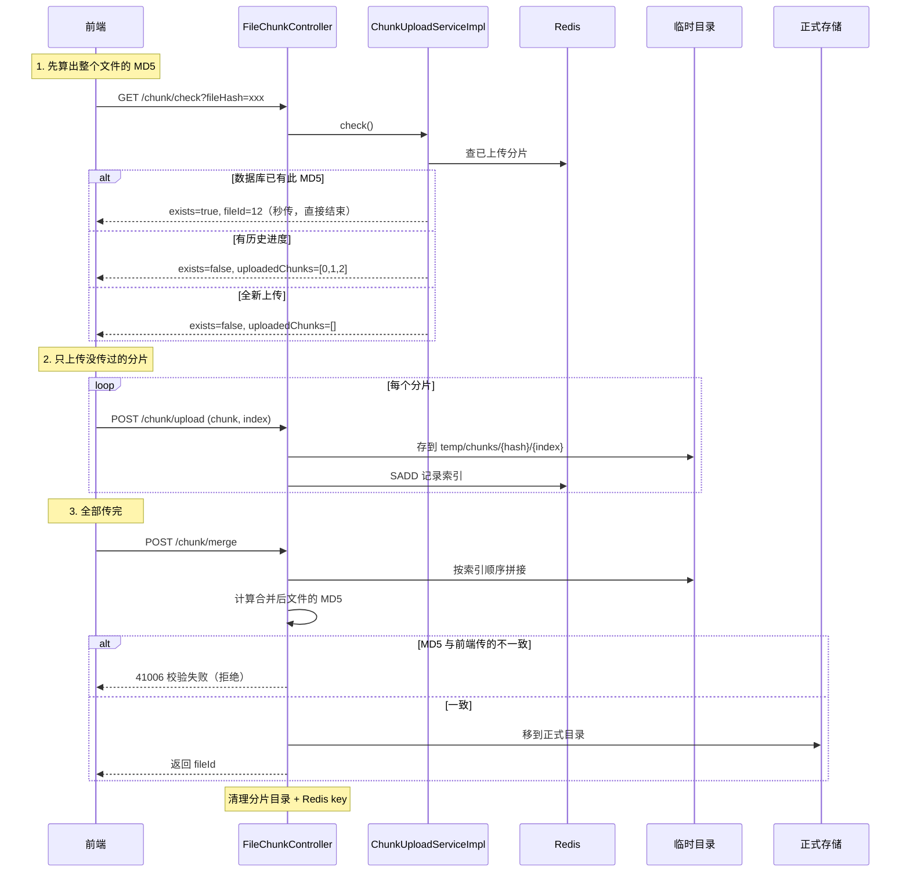

# 分片上传设计

> 本文对应代码：`ChunkUploadService` / `ChunkUploadServiceImpl` / `FileChunkController`
> 阅读目标：**搞懂大文件为什么要切块传、断点续传怎么实现、Redis 在这里到底存了什么**。

---

## 一、普通上传的两个硬伤

前面的 `POST /api/files/upload` 是"一次性把整个文件传上来"。对几百 KB 的 PDF 够用，
但遇到 500MB 的课件就会暴露问题：

| 硬伤 | 具体表现 |
|---|---|
| **断了要从头来** | 传了 99% 时网络抖一下，之前的全白费，只能重传 |
| **服务端压力大** | 一次要接收整个文件；请求超时时间也得设得很长 |

**分片上传**的思路很朴素：**把大文件切成固定大小的小块，一块一块传**。

```
500MB 的文件 ──切成 5MB 的块──> [块0][块1][块2]...[块99]
                                    ↓ 分别上传
                                 任何一块失败，只重传那一块
```

业界所有网盘、视频平台的大文件上传都是这个套路。

---

## 二、三个接口怎么配合



---

## 三、Redis 在这里存什么

### 存法

```
key:   coursehub:upload:chunk:{文件MD5}
type:  Set（集合）
value: 已上传的分片序号，如 {"0", "1", "2"}
TTL:   24 小时
```

### 为什么用 Set 而不是 List

**Set 天然去重**。用户网络不好重传了第 3 片，`SADD` 不会重复计数；
如果用 List，就会变成 `[0,1,2,2,3]`，算"传了几片"时就会算错。

### 为什么放 Redis 而不是数据库

| 原因 | 说明 |
|---|---|
| **是临时状态** | 文件传完这些信息就没用了，没必要污染业务数据库 |
| **写入极频繁** | 每个分片一次写，500MB 文件就是 100 次写 |
| **要自动过期** | 用户传一半就走了，24 小时后自动清掉，不用写清理任务 |

### 一个容易忽略的细节

**校验分片是否齐全时，应该看磁盘而不是看 Redis。**

```java
// 代码里是这么写的：遍历磁盘上的分片文件
for (int i = 0; i < totalChunks; i++) {
    if (!Files.exists(dir.resolve(String.valueOf(i)))) {
        missing.add(i);
    }
}
```

为什么？因为 **Redis 可能已过期（24 小时后被清空），但磁盘上的分片还在**。
磁盘才是"事实来源"。Redis 只用来做"快速查询已传进度"。

---

## 四、断点续传是怎么实现的

断点续传不是"从上次断开的那一字节继续"，而是**跳过已经传好的分片**：

```
用户传了 3 片后关掉浏览器
         ↓ 第二天重新打开
前端先调 check → 拿到 uploadedChunks = [0,1,2]
         ↓
前端只上传第 3、4、5...片（跳过 0,1,2）
```

所以关键就两个：
1. 服务端要**记住**已传的分片（Redis Set）
2. 前端要**先问一下**再决定传哪些（check 接口）

---

## 五、合并后的 MD5 复验（最容易被省掉、但最不该省）

### 要验什么

```
前端传的 fileHash    = 基于「原始文件」算出来的 MD5
后端合并后算的 MD5   = 基于「拼接后的文件」算出来的 MD5
                       ↓
                    两者必须完全一致
```

### 为什么必须验

分片上传有可能出这些岔子：

| 情况 | 后果 |
|---|---|
| 某个分片在传输中损坏 | 拼出来的文件是坏的 |
| 分片乱序拼接 | 文件内容全乱 |
| 最后一片截断 | 文件不完整 |

**如果不做复验，用户会下载到一个"看起来正常但打不开"的文件**，
而且很可能过了很久才被发现。做了复验，问题当场就暴露：

```java
String actualHash = FileUtil.md5(merged);
if (!actualHash.equalsIgnoreCase(fileHash)) {
    throw new BizException(ResultCode.FILE_HASH_MISMATCH);
}
```

这叫做**端到端完整性校验**，代价是合并时多算一次 MD5（对 500MB 文件约 1 秒），
换来的是"绝对不会存下一个坏文件"。

---

## 六、一个隐藏的安全点：hash 格式校验

```java
private void validateHash(String fileHash) {
    if (fileHash == null || !fileHash.matches("^[a-fA-F0-9]{32}$")) {
        throw new BizException(ResultCode.PARAM_ERROR, "文件哈希格式不正确");
    }
}
```

看起来只是"格式检查"，实际上是**安全防线**。

因为 `fileHash` 会被拼进临时目录路径：

```java
temp/chunks/{fileHash}/{chunkIndex}
```

如果不管字符集，攻击者传一个

```
fileHash = ../../../../Windows/System32
```

就能把分片文件写到系统目录里去 —— 这是**路径穿越攻击**。

限定成 `32 位十六进制` 后，只可能出现 `0-9a-f`，路径穿越彻底不可能。
**这就是"输入校验"最常见也最有效的用法：先缩小取值范围，再谈其他。**

---

## 七、怎么自己验证

### 一键跑

```bash
cd backend
bash verify-chunk.sh
```

### 测试用的真实文件

脚本默认用 **`E:\文件办公\PPT\文体活动.pptx`（50MB）**，会：
1. 算出整文件 MD5，切成 10 片
2. **先传 3 片**，然后调 check → 验证返回已传 `[0,1,2]`（**断点续传**）
3. 补传剩余 7 片
4. 合并 → 服务端做 MD5 复验
5. 下载回来 → **再算一次 MD5 比对**（验证内容真的没坏）
6. 再调 check → 应返回 `exists=true`（**秒传**）
7. 用这个文件发布成资料 → 验证和 M2-2 模块能串起来

想换文件的话，改 `test-chunk.py` 顶部的 `SRC_FILE` 即可。

### 亲眼看看临时目录

```bash
# 上传过程中看分片
ls "D:/桌面/Java项目AIGC/backend/upload/temp/chunks/"

# 合并完成后应该被清空
ls "D:/桌面/Java项目AIGC/backend/upload/temp/"
```

### 看看 Redis 里有什么

```bash
cd E:\java\redis
redis-cli.exe
> KEYS coursehub:upload:chunk:*
> SMEMBERS coursehub:upload:chunk:<某个hash>
> TTL coursehub:upload:chunk:<某个hash>
```

---

## 八、常见问题

| 现象 | 原因 | 排查 |
|---|---|---|
| 合并返回 41005（分片不完整） | 有分片没传成功 | 返回信息里会列出缺哪几片，前端重传即可 |
| 合并返回 41006（校验失败） | 分片内容损坏或拼接顺序错 | 检查前端切片逻辑：`slice(i*size, (i+1)*size)` |
| check 返回 40001 | fileHash 不是 32 位十六进制 | 检查前端 MD5 算法输出格式 |
| 断点续传不生效 | Redis 里没有记录 | 看 `KEYS coursehub:upload:chunk:*`；或已过 24 小时 TTL |
| 上传后 `upload/temp/chunks/` 有残留 | 合并失败了 | 查日志；目录会在下次同 hash 上传时复用/覆盖 |

---

## 九、这套设计的取舍

| 决策 | 好处 | 代价 |
|---|---|---|
| 5MB 分片 | 单次请求小、失败重传代价低 | 500MB 文件要 100 次请求 |
| 用 Redis 记进度 | 快、自动过期 | Redis 挂了就没有断点续传（已做降级：按全新上传处理） |
| 合并后才验 MD5 | 能发现所有分片问题 | 合并时要多读一遍文件 |
| 前端算 MD5 | 服务端省事 | 大文件前端算 MD5 会耗时，需要用 Web Worker |

> 真实系统还会在这上面加：**分片并发上传**（同时传 5 片，比顺序传快得多）、
> **分片大小自适应**（根据网速调整）、**服务端签名直传对象存储**
> （文件不经过应用服务器，直接传到 OSS/MinIO）。
> 本项目先把主干逻辑跑通，这些都可以在此基础上扩展。

---

## 十、下一步

**M2-4：中文全文检索** —— 用 MySQL 的 ngram 全文索引，
让"搜『数据结构』能命中『数据结构与算法』"，并对比它和 `LIKE '%x%'` 的性能差距。

相关文档：
- `docs/文件上传与存储设计.md` —— 单文件上传（本文的前置知识）
- `docs/资料管理与权限设计.md` —— 资料模块（分片上传的服务对象）
