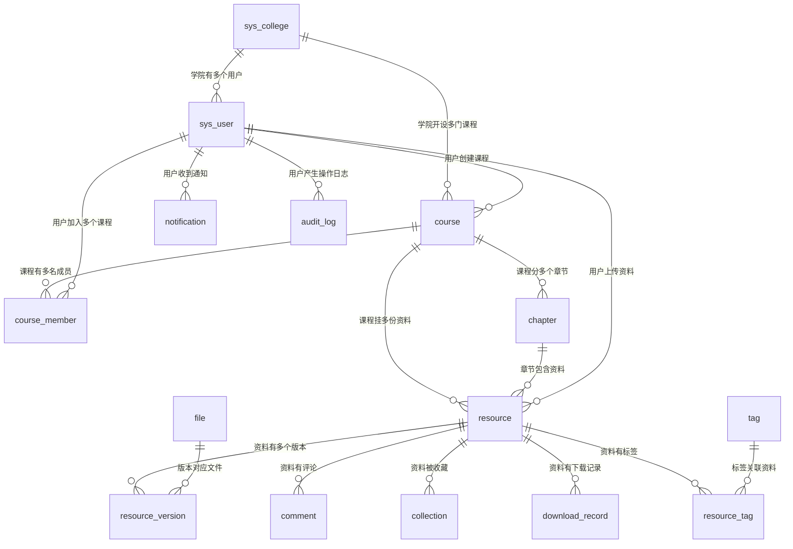

# 数据库表设计详解

> 本文面向**零项目基础**的读者，重点回答三个问题：
> **这张表是干什么的？ · 为什么需要它？ · 关键字段怎么理解？**
> 不涉及具体 SQL 写法，只讲设计意图。
>
> 建表脚本：`backend/sql/schema.sql`　种子数据：`backend/sql/init_data.sql`

---

## 一、先看全局：16 张表分成 4 组

一个课程资料平台，本质上要回答四个问题：

| 问题 | 对应表组 | 表 |
|---|---|---|
| **谁在用**？ | ① 用户与权限 | `sys_user`、`sys_college` |
| **资料放在哪**？ | ② 课程体系 | `course`、`course_member`、`chapter` |
| **资料本身是什么**？ | ③ 文件与资料 | `file`、`resource`、`resource_version` |
| **怎么互动与治理**？ | ④ 互动与治理 | `comment`、`collection`、`download_record`、`report`、`tag`、`resource_tag`、`notification`、`audit_log` |

### 表之间的关系（ER 图）



> mermaid 图在 GitHub 上能直接渲染成图形。

---

## 二、命名与设计约定（全表通用）

在看具体表之前，先记住这几条**贯穿所有表的规则**，后面就不重复解释了。

| 约定 | 说明 | 为什么这么做 |
|---|---|---|
| 表名、字段名用小写下划线 | `course_member`、`created_at` | MySQL 在 Linux 下大小写敏感，统一小写可避免换系统就报错 |
| 所有表都有 `created_at` | 创建时间 | 排查问题时"什么时候产生的"是第一手线索 |
| 业务表都有 `updated_at` | 更新时间，且 `ON UPDATE CURRENT_TIMESTAMP` | 由数据库自动维护，不靠代码记得去改 |
| 布尔值用 `tinyint(1)` | 0=否，1=是 | MySQL 没有真正的 boolean，tinyint(1) 是事实标准 |
| 枚举值用 `varchar` + 注释 | 如 `status = 'PUBLISHED'` | 不用 MySQL 的 `ENUM` 类型——改枚举值要锁表改结构，很不灵活 |
| 核心表有 `is_deleted` | 0=正常，1=已删除 | **逻辑删除**：不真删数据。用户误删能恢复，且资料被引用时不会出现"悬空外键" |

### 关于"逻辑删除"多说一句

新手最容易犯的错，是直接把 `DELETE FROM xxx` 当成删除。但这在真实系统里有三个问题：

1. **无法恢复** —— 用户手滑删了，找不回来
2. **破坏关联** —— 资料删了，但评论表里还引用着它，页面就崩了
3. **失去审计线索** —— 谁在什么时候删了什么，查不到

所以这里的做法是：**只把 `is_deleted` 改成 1，数据留在库里**。
所有查询语句都会带上 `AND is_deleted = 0`，用户看不出差别，但数据还在。

---

## 三、用户与权限（2 张）

### 1. `sys_user` —— 用户表

**作用**：存所有账号信息。这是全系统的"身份中心"。

| 字段 | 类型 | 作用 | 说明 |
|---|---|---|---|
| `id` | bigint | 主键 | 自增 |
| `username` | varchar(50) | 登录账号 | 学号或自定义，**唯一索引** |
| `password` | varchar(100) | 密码 | ⚠️ **存的是 BCrypt 哈希，绝不是明文** |
| `nickname` | varchar(50) | 昵称 | 页面展示用 |
| `avatar` | varchar(255) | 头像地址 | |
| `email` | varchar(100) | 邮箱 | |
| `student_no` | varchar(30) | 学号 | 与 username 分开，因为 username 也可能是自定义账号 |
| `college_id` | bigint | 所属学院 | 关联 `sys_college.id` |
| `role` | varchar(20) | 角色 | `STUDENT` / `ASSISTANT` / `TEACHER` / `ADMIN` |
| `credit_score` | int | 信用分 | 默认 100，违规扣分（上传垃圾资料会被扣） |
| `level` | tinyint | 贡献等级 | 1-5 级，上传优质资料会升级 |
| `status` | varchar(20) | 账号状态 | `ACTIVE` 正常 / `BANNED` 封禁 |
| `last_login_at` | datetime | 最后登录时间 | 安全审计用 |
| `created_at` / `updated_at` | datetime | 时间戳 | |
| `is_deleted` | tinyint(1) | 逻辑删除 | |

**关键设计点**

- **`password` 为什么必须加密**
  数据库一旦泄露，明文密码意味着所有人的账号直接被看光。BCrypt 是"单向哈希"——加密后无法还原，验证时是把用户输入重新加密再比对。它还自带随机盐，同一个密码每次加密结果都不同，`admin123` 这条记录无法被"用哈希表反查"。
  > 答辩常问：*为什么不用 MD5？* —— MD5 太快，黑客一秒能试几十亿次；BCrypt 故意设计得慢，暴力破解代价极高。

- **`idx_role_status` 组合索引**
  管理员要查"所有被封禁的学生"，查询条件是 `role=? AND status=?`。建 `(role, status)` 组合索引后，这个查询直接走索引。

- **`uk_username` 唯一索引**
  不只是"查得快"，更重要的是**数据库层面保证账号不重复**——两个请求同时注册同一账号时，第二个会被数据库拒绝。

---

### 2. `sys_college` —— 学院表

**作用**：存学院字典数据，是资料组织结构的**最上层**。

| 字段 | 类型 | 作用 |
|---|---|---|
| `id` | bigint | 主键 |
| `name` | varchar(100) | 学院名称，**唯一索引** |
| `code` | varchar(30) | 学院代码，如 CS |
| `sort_order` | int | 排序值，越小越靠前 |
| `created_at` | datetime | 创建时间 |

**为什么要单独建一张表，而不在用户表里存字符串？**

如果用户表里直接写 `college = '计算机学院'`，会有三个麻烦：
1. 学院改名要更新所有用户记录
2. 容易写错别字（"计算机学院" vs "计算机 学院"），变成两个不同的值
3. 没法统计"每个学院有多少用户"

单独建表 + 存 ID，就叫**规范化**。这是数据库设计的第一课。

---

## 四、课程体系（3 张）

### 3. `course` —— 课程表（容器）

**作用**：课程是**资料的容器**。每份资料都必须挂在某门课下，用户才能"按课程找资料"。

| 字段 | 类型 | 作用 | 说明 |
|---|---|---|---|
| `id` | bigint | 主键 | |
| `college_id` | bigint | 开设学院 | 关联 `sys_college.id` |
| `course_code` | varchar(30) | 课程编号 | 如 `DS-204` |
| `name` | varchar(100) | 课程名称 | 如"数据结构与算法" |
| `teacher` | varchar(50) | 授课教师 | |
| `term` | varchar(30) | 开课学期 | 如 `2026-2027-1` |
| `credit` | decimal(3,1) | 学分 | 用 decimal 不用 float——学分是精确值 |
| `cover` | varchar(255) | 封面图地址 | |
| `description` | text | 课程简介 | |
| `owner_id` | bigint | 课程负责人 | **数据权限判断的依据** |
| `member_count` | int | 成员数 | ⚠️ 冗余字段，见下方说明 |
| `resource_count` | int | 资料数 | ⚠️ 冗余字段 |
| `status` | varchar(20) | 状态 | `DRAFT` 草稿 / `PUBLISHED` 已发布 / `ARCHIVED` 已归档 |
| `created_at` / `updated_at` / `is_deleted` | | | |

**关键设计点**

- **冗余字段 `member_count` / `resource_count` 是干什么的**
  课程列表页要显示"成员 25 · 资料 8"。如果不存这两个字段，每渲染一条课程就要 `COUNT(*)` 查一次成员表——一页 9 条课程就是 9 次额外查询，这叫做 **N+1 查询问题**，数据一多就会拖垮数据库。
  做法是：**存一份冗余计数，在加入/退出课程时同步维护**。列表页直接读字段，零额外查询。

- **`ft_course` 全文索引（ngram 分词器）**
  让课程搜索支持中文。`LIKE '%数据结构%'` 这种写法**用不到索引**（因为开头是通配符，索引无法定位起点），数据量大后每个查询都要全表扫描。而 `FULLTEXT ... WITH PARSER ngram` 会把中文按字切分建索引，`MATCH ... AGAINST` 查询能走索引。

- **`idx_college_term` 组合索引**
  最常见的筛选是"某学院某学期的课程"，条件 `(college_id, term)`，正好对上。

---

### 4. `course_member` —— 课程成员表

**作用**：记录"谁加入了哪门课"，是用户和课程之间的**多对多关系**。

| 字段 | 类型 | 作用 |
|---|---|---|
| `id` | bigint | 主键 |
| `course_id` | bigint | 课程 ID |
| `user_id` | bigint | 用户 ID |
| `role` | varchar(20) | 课程内角色：`OWNER` 负责人 / `ASSISTANT` 助教 / `STUDENT` 学生 |
| `joined_at` | datetime | 加入时间 |

**关键设计点**

- **多对多为什么要用中间表**
  一个用户能加多门课，一门课有多个用户。这种"多对多"没法用一张表直接表达（课程表放不下多个用户，用户表也放不下多个课程）。标准解法就是中间表：每加一次课，就插一行记录。

- **`uk_course_user` 唯一索引（重要）**
  对 `(course_id, user_id)` 建唯一索引，作用是**防止重复加入**。用户连点两下"加入课程"，第二次会被数据库直接拒绝，而不是往库里插两条重复数据。

- **`idx_user` 索引**
  "我加入的课程"这个查询是 `WHERE user_id = ?`，需要按 user_id 快速定位。

---

### 5. `chapter` —— 章节表

**作用**：把一门课拆成章节（第一章、第二章……），让资料的组织更细。

| 字段 | 类型 | 作用 |
|---|---|---|
| `id` | bigint | 主键 |
| `course_id` | bigint | 所属课程 |
| `name` | varchar(100) | 章节名称 |
| `sort_order` | int | 排序 |
| `created_at` | datetime | |

**为什么资料不直接挂课程，还要多一层章节？**
一门"数据结构"课可能有几百份资料（各章讲义、真题、笔记）。不分章的话，用户面对一坨列表根本找不到东西。加了章节就是**多一级目录**：课程 → 第3章 → 树相关的讲义。

---

## 五、文件与资料（3 张）—— 本项目的核心

### 6. `file` —— 文件表

**作用**：存储**物理文件**的信息，与业务解耦。

| 字段 | 类型 | 作用 | 说明 |
|---|---|---|---|
| `id` | bigint | 主键 | |
| `file_hash` | char(32) | 文件 MD5 | ⚠️ **秒传的核心依据**，唯一索引 |
| `file_name` | varchar(255) | 原始文件名 | 用户上传时的名字 |
| `file_ext` | varchar(20) | 扩展名（小写） | 类型校验用 |
| `storage_path` | varchar(500) | 存储路径 | 相对路径，方便换存储后端 |
| `file_size` | bigint | 文件大小（字节） | |
| `mime_type` | varchar(100) | MIME 类型 | 二次校验文件类型 |
| `storage_type` | varchar(20) | 存储类型 | `LOCAL` 本地 / `MINIO` 对象存储 |
| `ref_count` | int | 引用次数 | 归零才可清理文件 |
| `uploader_id` | bigint | 上传者 | |
| `created_at` | datetime | | |

**关键设计点**

- **为什么要和 `resource` 分开**
  同一份"数据结构期末真题.pdf"，可能被多个课程的资料同时引用。如果每个资料都存一份文件信息，磁盘上会出现多份相同的文件，浪费空间。
  分开之后：**物理文件只存一份，多份资料引用它**。这就是 `ref_count`（引用计数）存在的意义——只有当没有任何资料引用时（`ref_count = 0`），才允许删除这个文件。

- **`file_hash`（MD5）是"秒传"的核心**
  上传文件前先算 MD5，拿这个值去表里查：
  - 查到 → 说明**这个文件已经有人传过了**，直接建立引用关系，**几毫秒完成**，不用真的传文件。这就是"秒传"。
  - 没查到 → 正常走上传流程。
  对 500MB 的课件，用户上传体验是"瞬间完成"。

---

### 7. `resource` —— 资料表（核心业务表）

**作用**：这是全系统**最核心**的表，一份"资料"就是一条记录。

| 字段 | 类型 | 作用 | 说明 |
|---|---|---|---|
| `id` | bigint | 主键 | |
| `course_id` | bigint | 所属课程 | |
| `chapter_id` | bigint | 所属章节 | 可为空 |
| `uploader_id` | bigint | 上传者 | |
| `current_version_id` | bigint | 当前版本 ID | 指向版本表的"最新版" |
| `title` | varchar(200) | 资料标题 | |
| `description` | text | 资料描述 | |
| `type` | varchar(30) | 类型 | `TEXTBOOK` 教材 / `LECTURE` 讲义 / `EXAM` 真题 / `NOTES` 笔记 / `ASSIGNMENT` 作业 / `VIDEO` 视频 / `OTHER` |
| `visibility` | varchar(20) | 可见性 | `PUBLIC` 全平台 / `COURSE_ONLY` 仅本课程 / `PRIVATE` 仅自己 |
| `status` | varchar(20) | 审核状态 | `PENDING` 待审核 / `PUBLISHED` 已发布 / `REJECTED` 已驳回 / `OFFLINE` 已下架 |
| `score` | decimal(5,2) | **可信度评分** | 0-100，定时重算（项目亮点之一） |
| `download_count` | int | 下载次数 | |
| `view_count` | int | 浏览次数 | |
| `favorite_count` | int | 收藏次数 | |
| `comment_count` | int | 评论数 | |
| `version_count` | int | 版本数量 | |
| `avg_rating` | decimal(2,1) | 平均评分 | 0-5 分 |
| `rating_count` | int | 评分人数 | |
| `reject_reason` | varchar(500) | 驳回原因 | 审核不通过时给用户看 |
| `created_at` / `updated_at` / `is_deleted` | | | |

**关键设计点**

- **`visibility` 三级可见性 —— 这是权限设计的关键**
  不是所有资料都该给所有人看。比如老师上传的"考试答案"只能本课程看到，"个人笔记"只能自己看。
  三级可见性把"能不能看"从"能不能进接口"里独立出来：**拦截器管功能权限（能进这个接口吗），`visibility` 管数据权限（能看这条数据吗）**。
  > 这是答辩高频考点：*改一下 URL 里的资料 ID 是不是就能看别人的私密资料？*
  > 答案是不能 —— Service 层会校验：如果资料是 `PRIVATE` 且 `uploader_id != 当前用户`，直接返回 403。

- **`idx_course_status_score` 组合索引（体现"最左前缀原则"）**
  资料列表页最常见的查询是：
  ```sql
  WHERE course_id = ? AND status = 'PUBLISHED' ORDER BY score DESC
  ```
  建 `(course_id, status, score DESC)` 后，**筛选和排序都在索引里完成**，不需要额外排序。
  可以用 `EXPLAIN` 验证：没有出现 `Using filesort` 就说明排序走了索引。
  > "最左前缀原则"：组合索引 `(a, b, c)` 能被 `WHERE a=?`、`WHERE a=? AND b=?` 使用，但**`WHERE b=?` 单独用不上**——因为索引是按 a 先排序的，跳过头一列就失去有序性。这也解释了为什么不能给每个字段都单独建索引：索引占空间，且增删改时都要同步维护。

- **`score` 为什么是 decimal 而不是 int**
  评分要算小数点（如 87.65），用整数会丢精度。金额、评分这类**精确值必须用 decimal**；`float`/`double` 是二进制浮点，会有 `0.1 + 0.2 = 0.30000000000000004` 这种精度问题。

---

### 8. `resource_version` —— 资料版本表（树形结构）

**作用**：记录资料的**每一次修改**，支持分支、合并与回滚。

| 字段 | 类型 | 作用 | 说明 |
|---|---|---|---|
| `id` | bigint | 主键 | |
| `resource_id` | bigint | 所属资料 | |
| `file_id` | bigint | 该版本的文件 | 指向 `file` 表 |
| `parent_version_id` | bigint | 父版本 ID | ⚠️ **NULL=根版本，这构成了"树"** |
| `version_no` | int | 版本号 | 分支内递增 |
| `branch` | varchar(50) | 分支名 | 默认 `main` |
| `change_log` | varchar(500) | 变更说明 | 这次改了什么 |
| `editor_id` | bigint | 编辑者 | |
| `is_rollback` | tinyint(1) | 是否回滚版本 | |
| `rollback_from_version_id` | bigint | 回滚来源版本 | |
| `created_at` | datetime | | |

**关键设计点**

- **`parent_version_id` 自关联 = 树**
  这是"版本树"的实现方式。每条版本记录指向它的"父版本"，形成一棵树：
  ```
  v1(根)
   ├─ v2
   │   └─ v3
   └─ v2'（从 v1 分出的另一条分支）
  ```
  线性版本（v1→v2→v3）只是树的一个特例。用树形结构，就能支持**多人同时改不同的部分**（分支），最后合并。

- **回滚为什么也要"留痕"**
  回滚不是把旧版本覆盖回来，而是**生成一条新版本**，标记 `is_rollback=1` 并记录 `rollback_from_version_id`。
  好处：历史永远完整。你能看到"3 月 1 日改动 → 3 月 5 日回滚到 3 月 1 日版本"这个完整链路，而不是版本凭空消失。

---

## 六、互动与治理（8 张）

### 9. `comment` —— 评论表

| 字段 | 类型 | 作用 |
|---|---|---|
| `id` | bigint | 主键 |
| `resource_id` | bigint | 评论的资料 |
| `user_id` | bigint | 评论者 |
| `parent_id` | bigint | 父评论（NULL=一级评论，否则是回复） |
| `root_id` | bigint | 根评论 ID（楼中楼聚合用） |
| `type` | varchar(20) | `NORMAL` 讨论 / `ERROR` 纠错 / `SUPPLEMENT` 补充 / `REPORT` 举报可疑 |
| `content` | text | 评论内容 |
| `like_count` | int | 点赞数 |
| `reply_count` | int | 回复数 |
| `is_top` | tinyint(1) | 是否置顶（老师的通知可置顶） |
| `status` | varchar(20) | `NORMAL` / `HIDDEN`（管理员隐藏） |
| `created_at` / `is_deleted` | | |

**设计说明**：`parent_id` + `root_id` 实现**两级评论**。一级评论是"直接评论资料"，二级是"回复某条评论"。`root_id` 记录它属于哪条一级评论，这样查"某条评论下所有回复"只需一次查询（`WHERE root_id = ?`），不用递归。

---

### 10. `collection` —— 收藏表

| 字段 | 作用 |
|---|---|
| `user_id` / `resource_id` | 谁收藏了哪份资料 |
| `folder` | 收藏夹名称（默认"默认收藏夹"） |
| `created_at` | 收藏时间 |

**关键设计**：`uk_user_resource` 唯一索引防止重复收藏。

---

### 11. `download_record` —— 下载记录表

| 字段 | 作用 |
|---|---|
| `resource_id` / `user_id` | 谁下载了哪份资料 |
| `ip` / `user_agent` | 下载来源（安全审计） |
| `created_at` | 下载时间 |

**为什么要单独记录**：资料的"下载次数"可以靠计数器，但**下载记录**能回答"谁下载过""有没有人恶意刷下载量"。这是审计能力。

---

### 12. `report` —— 举报表

| 字段 | 作用 |
|---|---|
| `reporter_id` | 举报人 |
| `target_type` / `target_id` | 举报对象（资料/评论/用户） |
| `reason` | `COPYRIGHT` 侵权 / `ERROR` 内容错误 / `OFFICIAL` 官方资料 / `AD` 广告 / `SPAM` 垃圾 / `OTHER` |
| `description` | 补充说明 |
| `status` | `PENDING` 待处理 / `HANDLED` 已处理 / `REJECTED` 已驳回 |
| `handler_id` / `handle_note` / `handled_at` | 谁处理的、怎么处理的、什么时候 |

**设计说明**：`target_type` + `target_id` 是**多态关联**——一张举报表能处理三种对象的举报，不用建三张表。

---

### 13. `tag` —— 标签表

| 字段 | 作用 |
|---|---|
| `name` | 标签名，唯一索引 |
| `usage_count` | 使用次数（用于"热门标签"排序） |

**为什么要计数器**：首页要显示"热门标签 TOP10"，如果每次都 `COUNT` 关联表排序，代价高。存一个计数字段直接排序即可。

---

### 14. `resource_tag` —— 资料标签关联表

| 字段 | 作用 |
|---|---|
| `resource_id` / `tag_id` | 资料与标签的多对多关系 |

**设计说明**：又是多对多，又是中间表。`uk_resource_tag` 防止同一资料重复打同一标签。

---

### 15. `notification` —— 通知表

| 字段 | 作用 |
|---|---|
| `user_id` | 接收者 |
| `type` | 通知类型（如"你的资料被评论了"） |
| `title` / `content` | 通知标题与内容 |
| `target_type` / `target_id` | 点击通知跳转到哪 |
| `is_read` | 是否已读 |
| `created_at` | 产生时间 |

**设计说明**：`target_type` + `target_id` 让通知变成"可跳转的"——点击"有人评论了你的资料"，直接跳到那条评论。

---

### 16. `audit_log` —— 操作审计日志表

| 字段 | 作用 |
|---|---|
| `user_id` | 操作人 |
| `username` | 操作人账号（**冗余存一份**） |
| `operation` | 操作描述 |
| `target_type` / `target_id` | 操作对象 |
| `detail` | 操作详情 |
| `ip` | 来源 IP |
| `created_at` | 操作时间 |

**关键设计点**

- **`username` 为什么冗余存**
  如果只存 `user_id`，用户注销后这条日志就查不出是谁干的了。**审计日志的意义就是"永久可追溯"，所以关键信息要冗余存一份快照**。

- **审计日志和普通业务日志的区别**
  应用日志（`log.info(...)` 输出的）是给开发排查 bug 用的，会定期清理；
  审计日志是**存数据库**的，记录"谁在什么时候做了什么"，用于追责，长期保留。

---

## 七、索引总结：一张表看懂"为什么这些字段要建索引"

| 表 | 索引 | 服务于哪个查询 |
|---|---|---|
| `sys_user` | `uk_username` | 登录时按账号查 |
| `sys_user` | `idx_role_status` | 管理员按角色+状态筛选 |
| `course` | `idx_college_term` | 按学院+学期筛选课程 |
| `course` | `ft_course` | 课程名中文搜索 |
| `course_member` | `uk_course_user` | 防止重复加入 |
| `resource` | `idx_course_status_score` | 资料列表（筛选+排序一次搞定） |
| `resource` | `ft_resource` | 资料名中文搜索 |
| `file` | `uk_file_hash` | 秒传（按 MD5 查文件是否已存在） |
| `resource_version` | `idx_resource_branch` | 查某资料某分支的版本列表 |
| `notification` | `idx_user_read_created` | 查"我的未读通知" |

**索引的本质**：像书的目录。没有目录，要找一句话得翻完整本书（全表扫描）；有目录，直接定位到页。
但索引不是免费的——**它占空间，且每次增删改数据都要同步更新索引**。所以原则是：**只给高频查询的字段建索引**，不是越多越好。

---

## 八、如果想自己动手看这些表

```bash
# 连接数据库（密码见你本地配置）
mysql -uroot -p coursehub

# 看所有表
SHOW TABLES;

# 看某张表的结构
DESC resource;

# 看某张表的建表语句（含索引）
SHOW CREATE TABLE resource\G

# 看一个查询用没用上索引
EXPLAIN SELECT id, title FROM resource
  WHERE course_id = 1 AND status = 'PUBLISHED' ORDER BY score DESC LIMIT 10;
```

`EXPLAIN` 结果里重点看三列：

| 列 | 期望值 | 含义 |
|---|---|---|
| `key` | 有索引名 | 实际用到的索引 |
| `type` | `ref` / `range` / `const` | 好的访问方式；若是 `ALL` 就是全表扫描 |
| `Extra` | 不含 `Using filesort` | 排序在索引里完成了 |

---

## 九、下一步

- 看具体接口怎么用这些表 → 读 `docs/接口清单.md`
- 看每个技术组件的作用 → 读 `docs/技术架构与中间件全景.md`
- 看每个文件干什么 → 读 `docs/项目文件说明.md`
