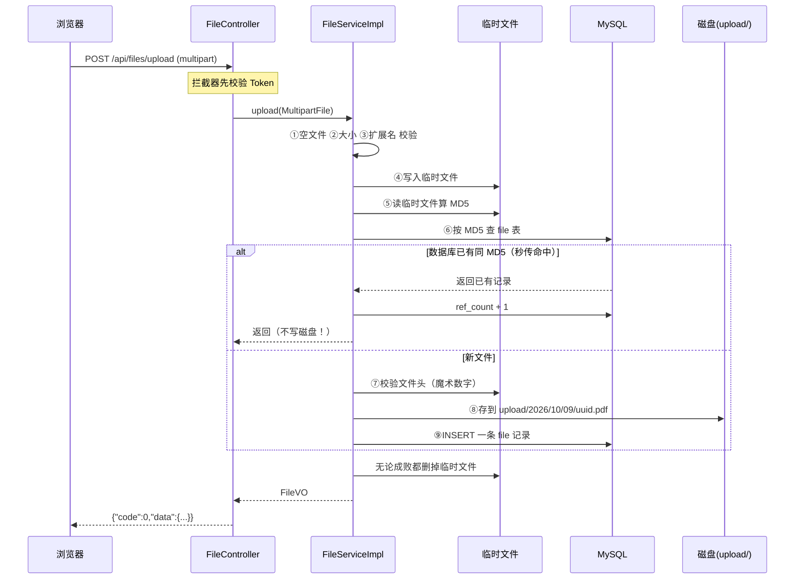

# 文件上传与存储设计

> 本文对应代码：`storage/` + `common/util/FileUtil.java` + `service/impl/FileServiceImpl.java`
> 阅读目标：**搞懂"一次文件上传，服务端到底做了什么"**，以及每一步在防什么问题。

---

## 一、先看全貌：一次上传发生了什么

你在网页上选了一个 `数据结构课件.pdf`，点了"上传"。接下来服务端发生的事情：



**一句话总结**：校验 → 落临时文件 → 算指纹 → 查重(秒传) → 验真身 → 换名存储 → 记数据库 → 清理临时文件。

---

## 二、为什么要抽象出 `FileStorage` 这一层

### 不抽象会怎样

最直接的做法是在 Service 里写：

```java
// ❌ 反面写法
File dest = new File("D:/upload/" + filename);
file.transferTo(dest);
```

问题在于 **"文件存哪儿"这件事是会变的**：

| 阶段 | 存储位置 | 触发变更的原因 |
|---|---|---|
| 开发阶段 | 本地磁盘 `D:/upload` | 简单，够用 |
| 上线到服务器 | 服务器磁盘 `/data/upload` | 换机器了 |
| 多台服务器 | **必须用对象存储**（MinIO/OSS） | 用户传到 A 机器，从 B 机器下载时文件不在！ |

最后一条是关键：**一旦部署多台服务器，本地磁盘方案直接失效**——因为文件只存在于某一台上。

### 抽象之后

```java
public interface FileStorage {
    String store(String relativePath, InputStream in);
    InputStream load(String relativePath);
    boolean delete(String relativePath);
    ...
}
```

- 现在：`LocalFileStorage` 实现了"存本地磁盘"
- 以后：再写一个 `MinioFileStorage`，配置里把
  `coursehub.file.storage-type` 从 `local` 改成 `minio`
- **业务代码一行都不用改**

看 `LocalFileStorage` 上的这个注解就是这么干的：

```java
@ConditionalOnProperty(name = "coursehub.file.storage-type",
                       havingValue = "local", matchIfMissing = true)
```

它的意思是："**只有当配置值是 local 时，才创建我这个 Bean**"。将来写了 MinIO 实现，配置一改，Spring 自动换成另一个实现。

> 这就是「面向接口编程」的实际价值——不是背概念，而是"换实现不用改调用方"。

---

## 三、数据库里存的是什么

`file` 表有一条记录长这样：

| 字段 | 值 | 说明 |
|---|---|---|
| `id` | 12 | 主键 |
| `file_hash` | `d41d8cd98f00b204e9800998ecf8427e` | MD5 指纹 |
| `file_name` | `数据结构课件.pdf` | **用户看到的原始名** |
| `file_ext` | `pdf` | 扩展名（小写） |
| `storage_path` | `2026/10/09/a1b2c3d4e5f67890.pdf` | **磁盘上的真实路径** |
| `file_size` | 2621440 | 字节 |
| `ref_count` | 1 | 被引用次数 |
| `uploader_id` | 1 | 上传者 |

**注意 `file_name` 和 `storage_path` 是分开的两个字段**，这是刻意设计：

- 用户传的原始名 → 存 `file_name`，下载时还原回去给用户看
- 磁盘上的名字 → 由服务端生成的 UUID，用户完全看不到

为什么要这样分？见下一节第 5 条。

---

## 四、上传的 9 个步骤，每步在防什么

代码在 `FileServiceImpl.upload()`，每一步都有注释。这里做整体梳理：

| 步骤 | 做什么 | 防什么问题 |
|---|---|---|
| ① | 判空 | 前端漏传、网络截断导致空请求 |
| ② | 判大小 | 有人传 10GB 文件占满磁盘 |
| ③ | 扩展名白名单 | 上传 `.exe` / `.jsp` 等可执行文件 |
| ④ | 落临时文件 | 后续要多次读取内容（算 MD5、验文件头） |
| ⑤ | 算 MD5 | 得到文件"指纹"，用于查重 |
| ⑥ | 查重（秒传） | 同一份文件重复上传，浪费存储和带宽 |
| ⑦ | 校验文件头 | **扩展名可以改，文件头改不了** |
| ⑧ | UUID 重命名 + 按日期分目录 | 见下方第 5 条 |
| ⑨ | 写数据库 | 记录元信息，供查询和下载 |

---

## 五、五重安全校验详解（重点）

### 1. 空文件检查

```java
if (file == null || file.isEmpty()) throw new BizException(ResultCode.FILE_EMPTY);
```

看起来是废话，但**没有它，后面 `md5()` 会得到一个"空字符串的 MD5"**，然后所有空文件都会互相命中秒传，逻辑就乱了。

### 2. 大小检查

```java
if (file.getSize() > maxSize) throw ...;  // maxSize = 500MB
```

三种限流位置要分清：

| 层次 | 配置位置 | 作用 |
|---|---|---|
| Nginx | `client_max_body_size` | 最外层，请求还没进 Java 就被拦 |
| Spring | `spring.servlet.multipart.max-file-size` | 进入 Spring 时的限制 |
| 业务代码 | 这里的 `maxSize` | 最终把关，可返回友好错误码 |

三个都配是为了"层层设防"：前两层挡掉大部分非法请求，业务层给出明确的错误提示。

### 3. 扩展名白名单

```java
if (!FileUtil.isAllowedExtension(ext)) throw ...;
```

**为什么用白名单而不是黑名单？**

```
黑名单思路：禁止 .exe .bat .sh .jsp ...
```

攻击者只要找到一个你没列进去的后缀就绕过了。而且新的危险后缀永远在出现。

```
白名单思路：只允许 .pdf .docx .jpg ...
```

**默认拒绝**，不在名单里的一律不准。这是安全设计的基本原则——**允许列表（allowlist）优于拒绝列表（denylist）**。

### 4. 文件头校验（魔术数字）

这一步最容易被忽略，但很关键。

**问题**：扩展名只是文件名的后缀，改起来太容易了。

```bash
# 把一个木马程序改名为"课件.pdf"
mv trojan.exe 课件.pdf
```

此时前面的扩展名检查**完全拦不住**。

**解决**：看文件内容的头几个字节。每种文件格式都有固定的"文件头"（也叫魔术数字 Magic Number）：

| 格式 | 文件头（十六进制） | 可读形式 |
|---|---|---|
| PDF | `25 50 44 46` | `%PDF` |
| PNG | `89 50 4E 47` | — |
| JPG | `FF D8 FF` | — |
| ZIP / docx / xlsx / pptx | `50 4B 03 04` | `PK..` |
| RAR | `52 61 72 21` | `Rar!` |
| doc / xls / ppt（旧版） | `D0 CF 11 E0` | — |

**这个字节是文件格式本身决定的，改不了**——把 PDF 的文件头改掉，它就不是一个能打开的 PDF 了。

所以"扩展名 + 文件头"两道一起验，才能确认"这确实是个 PDF"。

> ⚠️ 注意：`txt` / `md` 是纯文本，**没有固定的文件头**，所以对这两种类型跳过文件头校验（只做扩展名白名单）。任何安全措施都要考虑"误杀正常文件"的代价。

### 5. UUID 重命名（这道防线最隐蔽）

```java
String relativePath = FileUtil.buildRelativePath(ext);
// 结果形如：2026/10/09/a1b2c3d4e5f67890abcdef.pdf
```

**为什么不能用用户传的文件名直接当存储路径？三个原因：**

**① 路径穿越攻击（Path Traversal）**

假设不重命名，且代码天真地拼路径：

```java
Path target = rootPath.resolve(userFileName);   // rootPath = D:/upload
```

用户把文件名传成：

```
../../../../Windows/System32/drivers/etc/hosts
```

拼出来就是 `D:/upload/../../../../Windows/System32/...`，
经 `normalize()` 化简后跑到了系统目录——**攻击者可以读、甚至覆盖系统文件**。

`LocalFileStorage.resolveSafely()` 就是防这个的，核心三步：

```java
Path target = rootPath.resolve(relativePath).normalize();  // 1.拼接 2.化简掉 ../
if (!target.startsWith(rootPath)) {                        // 3.必须仍在根目录内
    throw new BizException(ResultCode.FORBIDDEN, "非法的文件路径");
}
```

> **顺序很重要**：必须先 `normalize()` 再 `startsWith()`。
> 如果先判断后化简，`a/../../b` 这种写法就能绕过。

**② 同名覆盖**

两个人先后上传 `第1章课件.pdf`，后传的会把先传的覆盖掉。

**③ 特殊字符**

中文、空格、`#`、`?` 等字符在不同操作系统和 URL 里的处理方式不一致，容易出各种诡异问题。

用 UUID 重命名后，磁盘上的名字是纯 ASCII 随机串，**和用户输入完全无关**，以上三个问题一并解决。

---

## 六、秒传：让 500MB 的文件"瞬间传完"

### 原理

```
上传前先算 MD5 → 拿这个值去 file 表查
     ├── 查到了  → 说明这份文件已经有人传过
     │            只把 ref_count +1，直接返回，不写磁盘
     └── 没查到  → 正常走完整流程
```

**为什么"同一个 MD5 = 同一份文件"**：MD5 是内容摘要算法，内容只要差一个字节，结果就完全不同（雪崩效应）。所以 MD5 相同基本可以认定文件内容相同。

**跨用户也生效**：A 同学传过"张老师的数据结构课件"，B 同学再传同一份（哪怕文件名不一样），也会命中秒传。

### 实测效果

项目测试脚本里验证了这一点：

```
[3] 上传 数据结构课件.pdf   → instantUpload: false（首次上传）
[4] 上传 换个名字.pdf       → instantUpload: true, id 与上次相同（秒传命中）
```

注意第 4 步返回的 `id` 和第一次**完全一样**——说明没有新建记录，只是复用了已有文件。

### 那为什么还要存 MD5 到数据库

`file.file_hash` 字段上有唯一索引 `uk_file_hash`。除了给秒传用，它还保证了**数据库层面不会有两条相同 MD5 的记录**。

---

## 七、引用计数：为什么不能直接删文件

### 场景

一门"数据结构"课上传了《期末真题.pdf》。
另一门"算法设计"课也想用同一份 —— 因为内容完全一样，**秒传生效，两门课指向同一个物理文件**。

此时 `file` 表里那条记录的 `ref_count = 2`。

### 问题

如果这时第一门课删掉了资料，代码直接执行：

```java
fileStorage.delete(storagePath);  // ❌ 删物理文件
```

会发生什么？**第二门课的资料也打不开了**，因为文件被删了。

### 正确做法

```java
fileMapper.decreaseRefCount(id);      // 引用计数 1（2 - 1）
// 再查一次
if (refCount <= 0) {
    fileStorage.delete(storagePath);  // 这时才说明真的没人用了
    fileMapper.deleteById(id);        // 顺手清掉数据库记录
}
```

**计数减到 0 才删** —— 这和很多系统里的"垃圾回收"思路一样：只有当没有任何人引用时，资源才能释放。

---

## 八、怎么自己验证

### 方式一：跑自动化测试

```bash
cd backend
# 同一条命令内启动后端并测试（重要，见下方"常见错误"）
```

测试脚本 `backend/test-file.py` 覆盖 11 组场景，包括：

| 场景 | 预期 |
|---|---|
| 未登录上传 | 返回 40101 |
| 正常上传 PDF | 成功，`instantUpload=false` |
| 同一文件再传 | `instantUpload=true`，ID 相同 |
| 上传 `.exe` | 40103（类型不允许） |
| 伪装文件（`.pdf` 但内容是文本） | 40103 |
| 无扩展名 | 40103 |
| 下载比对 MD5 | 内容与原文件一致 |
| 删除后查询 | 40406（记录已清除） |

### 方式二：手工用页面测

1. 启动后端，打开 `http://localhost:8080/doc.html`
2. 找到「04-文件」→「上传文件」
3. 先登录拿 Token，在「全局参数」里加上
4. 选一个 PDF 上传，观察返回的 `instantUpload` 字段
5. 同一个文件再传一次，看它变成 `true`

### 方式三：直接看磁盘

上传成功后，打开 `D:\桌面\Java项目AIGC\backend\upload\`（路径相对于后端工程目录），你会看到：

```
upload/
├── 2026/
│   └── 10/
│       └── 09/
│           └── a1b2c3d4e5f67890abcdef.pdf   ← UUID 文件名
└── temp/                                       ← 临时目录，正常情况下是空的
```

**按日期分目录**的原因：如果所有文件都堆在一个目录里，几万个文件后文件系统检索会明显变慢。

**`temp/` 是空的**说明临时文件被正确清理了——如果里面堆了文件，说明清理逻辑有问题。

---

## 九、常见错误与排查

| 现象 | 原因 | 怎么查 |
|---|---|---|
| 上传返回 41002 | 超过大小限制 | 检查 `coursehub.file.max-size` 和 `spring.servlet.multipart.max-file-size` |
| 上传返回 41003，但文件看着没问题 | 文件头校验没过 | 文件可能真的不是该格式；或该格式未登记魔数（如 txt 不受影响） |
| 下载下来文件名乱码 | HTTP 头没按 RFC 5987 编码 | 检查 `ContentDisposition.filename(name, UTF_8)` |
| `upload/` 目录里出现一堆 `upload-xxxx.tmp` | 临时文件没清理 | 检查 `finally` 块是否执行（异常路径也要清理） |
| 应用启动报找不到 `LocalFileStorage` | 配置写错 | `coursehub.file.storage-type` 必须是 `local` 或留空 |
| 本地测试时后端"未就绪" | 启动后端子进程被回收 | 见下方 |

### ⚠️ 关于本项目的验证脚本（踩过的坑）

**不要把"启动后端"和"跑测试"分成两条命令执行。**

原因是：后台启动的 Java 进程会在命令结束时被回收，导致测试连不上后端、误报"后端未就绪"。

正确做法是**放在同一条命令里**：

```bash
# 启动 Redis → 启动后端 → 等待 → 跑测试 → 清理
cd "E:/java/redis" && (./redis-server.exe redis.conf > /dev/null 2>&1 &); sleep 3
cd backend
export JAVA_HOME="E:/java/jdk11"
mvn spring-boot:run -Dspring-boot.run.arguments=--server.port=8080 > app-run.log 2>&1 &
sleep 38
python test-file.py
taskkill //F //IM java.exe
```

---

## 十、这套设计的取舍（值得想一想）

| 决策 | 好处 | 代价 |
|---|---|---|
| 用 MD5 而不是 SHA-256 | 算得快 | MD5 已被证明有碰撞可能（理论上能构造两个不同内容但相同 MD5 的文件） |
| 秒传依赖 MD5 | 上传体验极好 | 攻击者可能用"MD5 碰撞"让自己上传的文件伪装成别人的 |
| 本地存储 | 零依赖，开发方便 | 无法多机部署 |
| 文件 IO 放在 `@Transactional` 里 | 代码连贯好懂 | 事务开得久，占用数据库连接 |

> 真实的生产系统会在这些点上做更细的权衡（比如用 SHA-256、用分片上传绕过秒传风险、把文件 IO 移出事务）。
> **知道"每个选择都有代价"，比记住"标准答案"更重要。**

---

## 十一、下一步

下一个模块是**资料管理（Resource）**：把上传的文件"挂"到课程和章节下，并加上三级可见性（全平台 / 仅本课程 / 仅自己）。

相关文档：
- `docs/数据库表设计详解.md` —— `file` 与 `resource` 两张表的关系
- `docs/接口清单.md` —— 文件接口的完整参数说明
