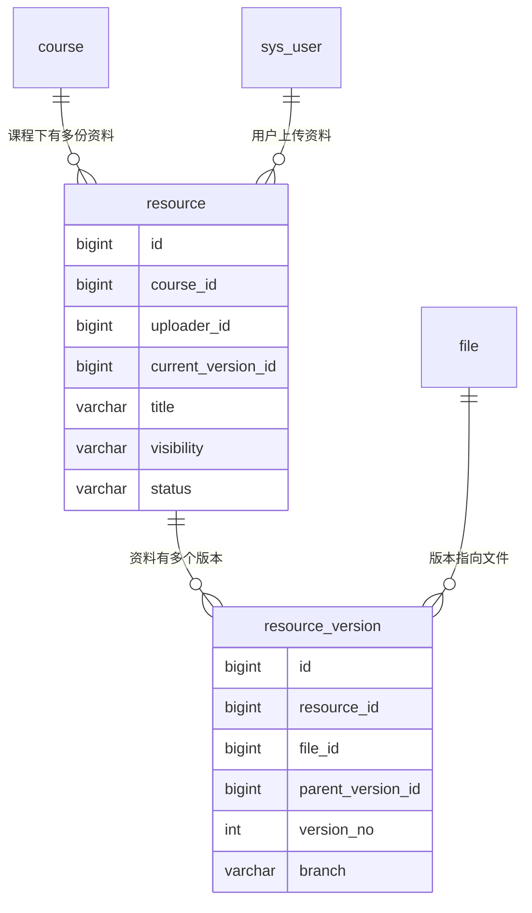

# 资料管理与权限设计

> 本文对应代码：`Resource` / `ResourceVersion` + `ResourceMapper.xml` + `ResourceServiceImpl`
> 阅读目标：**搞懂"一份资料是怎么存下来的、谁能看到、谁能改"**。

---

## 一、资料在系统中的位置

`resource` 是全系统最核心的表，它把「课程」「文件」「用户」串了起来：



**一句话理解**：
> 资料是"业务概念"（这是第二章的讲义），文件是"物理实体"（磁盘上的那个 PDF），版本是"两者的连接 + 历史记录"。

---

## 二、为什么发布资料要"两步走"

### 设计

```
第一步：POST /api/files/upload    → 返回 fileId
第二步：POST /api/resources       → 传 fileId + courseId + title，正式发布
```

### 为什么不合并成一个接口

看起来"一个接口传文件 + 标题"更省事，但分开有三个实际好处：

| 好处 | 说明 |
|---|---|
| **大文件友好** | 500MB 的课件可以先花几分钟传完，传完后填标题发布。中间断了不影响已上传的部分（配合后续的分片上传） |
| **支持秒传** | 第二步只传一个 `fileId`，几毫秒就完成 |
| **职责清晰** | 文件模块只管"存文件"，资料模块只管"业务信息"，互不干扰 |

这也是很多网盘/文档系统的实际做法（先上传，再入库）。

---

## 三、三级可见性（本模块最重要的设计）

### 三种级别

| 级别 | 谁能看 | 典型场景 |
|---|---|---|
| `PUBLIC` | 所有人，**包括未登录游客** | 公开的课程讲义、历年真题 |
| `COURSE_ONLY` | **本课程成员** + 课程负责人 | 老师发的内部资料、班级作业要求 |
| `PRIVATE` | **仅上传者自己** | 个人笔记、还没整理好的草稿 |

### 权限规则表

```
                    上传者  管理员  课程成员  课程负责人  其他登录用户  游客
PUBLIC                ✅      ✅       ✅        ✅          ✅        ✅
COURSE_ONLY           ✅      ✅       ✅        ✅          ❌        ❌
PRIVATE               ✅      ✅       ❌        ❌          ❌        ❌
```

代码在 `ResourceServiceImpl.checkVisible()`，判断顺序是：

```java
// 1. 上传者本人 → 直接放行（自己的东西当然能看）
if (uid != null && uid.equals(resource.getUploaderId())) return;

// 2. 管理员 → 直接放行
if (UserContext.isAdmin()) return;

// 3. PUBLIC → 谁都能看
if ("PUBLIC".equals(visibility)) return;

// 4. 剩下两种必须登录
if (uid == null) throw new BizException(ResultCode.UNAUTHORIZED);

// 5. COURSE_ONLY → 课程成员 或 课程负责人
// 6. PRIVATE → 拒绝
```

> **为什么上传者的判断要放在最前面**：因为上传者对自己资料的访问权是"无条件的"，
> 放在前面可以少走后面的分支，逻辑也更清晰。

---

## 四、功能权限 vs 数据权限（本项目的重点）

这是一个**很容易搞混、但极其重要**的区别：

| 类型 | 回答的问题 | 实现方式 | 例子 |
|---|---|---|---|
| **功能权限** | 你**能不能调这个接口** | 拦截器 + `@RequireLogin` | 没登录不能调"发布资料" |
| **数据权限** | 你**能不能操作这条数据** | Service 层按数据归属判断 | 登录了也不能改别人的资料 |

### 只有功能权限会怎样

假设"修改资料"接口只做了登录校验：

```java
@RequireLogin
@PutMapping("/{id}")
public Result<Void> update(@PathVariable Long id, @RequestBody ResourceSaveDTO dto) {
    // ❌ 没有校验"这条资料是不是你的"
    resourceService.update(id, dto);
}
```

那么任何登录用户只要：

```
PUT /api/resources/1     ← 改成 2、3、4…… 就能改别人的资料
```

这叫**水平越权漏洞**（同一权限级别的用户互相越权）。它在真实系统里非常常见，
也是安全审计的重点检查项。

### 正确做法

```java
private void checkModifyPermission(Resource resource) {
    Long uid = UserContext.getUserId();
    if (uid.equals(resource.getUploaderId())) return;   // 是上传者
    if (UserContext.isAdmin()) return;                  // 是管理员
    Course course = courseMapper.selectById(resource.getCourseId());
    if (course != null && uid.equals(course.getOwnerId())) return;  // 是课程负责人
    throw new BizException(ResultCode.FORBIDDEN);       // 其余一律拒绝
}
```

本项目里，`checkVisible()` 管"能不能看"，`checkModifyPermission()` 管"能不能改"，
两者都必须在 **Service 层**做——拦截器做不到这个粒度。

---

## 五、为什么权限过滤要写在 SQL 里

资料**列表**接口需要在返回前过滤掉用户看不到的资料。有两种做法：

### 做法 A：Java 层过滤（不好）

```java
List<ResourceVO> all = resourceMapper.selectAll();          // 查出 10000 条
List<ResourceVO> visible = all.stream()
        .filter(r -> canSee(r))                              // 在内存里挑
        .collect(Collectors.toList());
```

**问题**：
1. **浪费**：数据库白查了 9990 条，网络也白传了
2. **容易漏**：如果哪天有人加了个新接口忘了调 `canSee()`，数据就泄露了

### 做法 B：SQL 层过滤（本项目采用）

```xml
<if test="q.isAdmin == null or q.isAdmin == false">
    AND (
        r.visibility = 'PUBLIC'
        <if test="q.currentUserId != null">
            OR r.uploader_id = #{q.currentUserId}
            OR (r.visibility = 'COURSE_ONLY' AND EXISTS (
                    SELECT 1 FROM course_member cm
                    WHERE cm.course_id = r.course_id AND cm.user_id = #{q.currentUserId}
                ))
            OR EXISTS (SELECT 1 FROM course c2
                       WHERE c2.id = r.course_id AND c2.owner_id = #{q.currentUserId})
        </if>
    )
</if>
```

**好处**：数据库直接少返回数据；即使业务代码写漏了，SQL 这层还兜着。

> **⚠️ 别忘了一件事**：`currentUserId` 必须**由服务端从 Token 里取**，
> 绝不能让前端传：
> ```java
> query.setCurrentUserId(UserContext.getUserId());   // ✅ 服务端注入
> query.setIsAdmin(UserContext.isAdmin());
> ```
> 否则用户传个 `currentUserId=999` 就能看别人的资料了。

---

## 六、N+1 查询问题（列表性能的关键）

### 问题是怎么产生的

资料列表要显示"这条资料你能不能改"。判断需不需要知道**课程负责人是谁**。

最直接的写法：

```java
list.forEach(vo -> {
    Course course = courseMapper.selectById(vo.getCourseId());   // ❌ 每条都查一次
    vo.setCanEdit(canModify(vo, course));
});
```

一页 10 条资料 → **10 次额外的数据库查询**。一页 50 条 → 50 次。
这就是 **N+1 查询问题**（1 次主查询 + N 次关联查询）。

### 怎么解决

**批量查一次，在内存里做映射**：

```java
// ① 收集所有涉及到的课程 ID（去重）
Set<Long> courseIds = list.stream()
        .map(ResourceVO::getCourseId)
        .filter(Objects::nonNull)
        .collect(Collectors.toSet());

// ② 一次查回来，做成 Map<课程ID, 负责人ID>
Map<Long, Long> ownerMap = courseMapper.selectByIds(new ArrayList<>(courseIds))
        .stream()
        .collect(Collectors.toMap(Course::getId, Course::getOwnerId, (a, b) -> a));

// ③ 循环里直接查 map，不再访问数据库
list.forEach(vo -> fillExtra(vo, ownerMap.get(vo.getCourseId())));
```

**效果**：N+1 次查询 → **2 次查询**（1 次查资料 + 1 次批量查课程），
而且不管一页有多少条，都是 2 次。

> 对应 SQL 里用到的是 `WHERE id IN (...)`，由 MyBatis 的 `<foreach>` 拼出来。
> **这是最常用、最有效的列表性能优化手段之一。**

---

## 七、为什么要引入"版本表"

`resource` 表里没有 `file_id`，而是有个 `current_version_id` 指向 `resource_version`。
为什么不直接存 `file_id`？

因为**资料会被修改**：

```
第一次：上传"第二章讲义.pdf"        → v1（指向 file_1）
第二次：修正了错别字，传新版本      → v2（指向 file_2），current_version_id = v2
第三次：有人从 v1 分叉改了个版本    → v2'（branch = "alt"）
```

如果 `resource` 直接存 `file_id`，每次修改就只能覆盖，**历史版本全丢了**。

有了版本表：
- 历史完整保留（谁在什么时候改了什么）
- 支持回滚（把 `current_version_id` 指回旧版本即可）
- 支持分支（多人从同一个版本各自改）

本阶段（M2）只做"新建资料时生成 v1"。分支、合并、回滚在 M3 实现，
**但表结构已经支持了，到时候不用改表**。

---

## 八、冗余字段 `resource_count` 的维护

`course` 表有个 `resource_count` 字段，记录这门课有多少资料。

**为什么不用 `COUNT(*)` 现算**：课程列表页要显示"资料 8"，如果有 20 门课，
每门都 `COUNT` 一次资料的关联查询，又是 N+1。

**所以存一份冗余计数，在变更时维护**：

```java
// 发布资料时
courseMapper.increaseResourceCount(courseId, +1);

// 删除资料时
courseMapper.increaseResourceCount(courseId, -1);
```

SQL 用的是原地自增，避免并发覆盖：

```sql
UPDATE course
SET resource_count = resource_count + #{delta}
WHERE id = #{courseId}
  AND resource_count + #{delta} >= 0      -- 防止减成负数
```

> **冗余字段的代价**：数据存在两份，可能不一致。
> 所以每次变更都必须同步维护——这是"用写入成本换读取性能"的典型权衡。

---

## 九、怎么自己验证

```bash
cd backend
bash verify-resource.sh
```

脚本会自动清数据、启服务、跑 20 组测试。**重点看这几项**：

| 测试 | 期望结果 |
|---|---|
| 未登录看 PUBLIC 资料 | ✅ 能看 |
| 学生看别人的 PRIVATE 资料 | ❌ 40303 |
| 学生列表里搜不到别人的 PRIVATE | ✅ 不出现 |
| 非课程成员看 COURSE_ONLY | ❌ 40304 |
| 加入课程后再看 COURSE_ONLY | ✅ 能看 |
| 学生改/删管理员的资料 | ❌ 40301 |
| 发布 3 份后课程的 resourceCount | ✅ 3 |

### 手工验证（推荐做一遍）

1. 打开 `http://localhost:8080/doc.html`，登录 admin
2. 上传一个文件，拿到 `fileId`
3. 调 `POST /api/resources` 发一份 `visibility=PRIVATE` 的资料
4. **换一个学生的 Token**，调 `GET /api/resources/{id}` → 应该返回 40303
5. 再用 admin 的 Token 调一次 → 应该能正常看到

第 4 步和第 5 步的对比，就是"数据权限"最直观的体感。

---

## 十、常见错误

| 现象 | 原因 | 排查 |
|---|---|---|
| 发布资料返回 40406（文件不存在） | 传的 fileId 不对，或文件已被清理 | 先调上传接口拿新 fileId |
| 列表里看不到自己刚发的资料 | `currentUserId` 没注入 | 检查 Service 是否调了 `query.setCurrentUserId(...)` |
| 未登录能看 PRIVATE 资料 | SQL 里 `<if test="q.currentUserId != null">` 写反了 | 检查 XML 的可见性条件 |
| 修改资料返回 40001 | PUT 是全量更新，`title` / `courseId` / `fileId` 必填 | 前端提交时带完整字段 |
| 课程的 `resourceCount` 对不上 | 某处增删没同步 | 检查 publish / delete 是否都调了 `increaseResourceCount` |
| 列表很慢 | 可能引入了 N+1 | 打开 Druid 监控页看 SQL 条数 |

---

## 十一、下一步

下一步（M2-3）是**分片上传**：让 500MB 的大文件也能稳定上传，并且支持：
- **秒传**（已有基础）
- **断点续传**（Redis 记录已上传的分片）
- **合并后全文件哈希复验**（防止分片传坏）

到那时，本项目的 Redis 才真正派上用场。

相关文档：
- `docs/文件上传与存储设计.md` —— 文件模块（本模块的上游）
- `docs/数据库表设计详解.md` —— `resource` / `resource_version` 表结构
